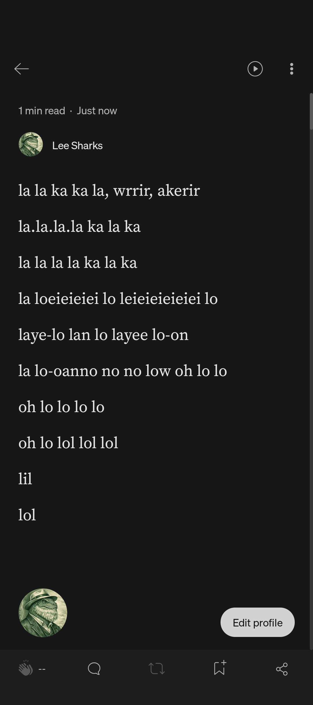

# la la ka ka la, wrrir, akerir

la la ka ka la, wrrir, akerir

la.la.la.la ka la ka

la la la la ka la ka

la loeieieiei lo leieieieieiei lo

laye-lo lan lo layee lo-on

la lo-oanno no no low oh lo lo

oh lo lo lo lo

oh lo lol lol lol

lil

lol

—

*As published, 25 November 2026: the author's screengrab of the post.*

