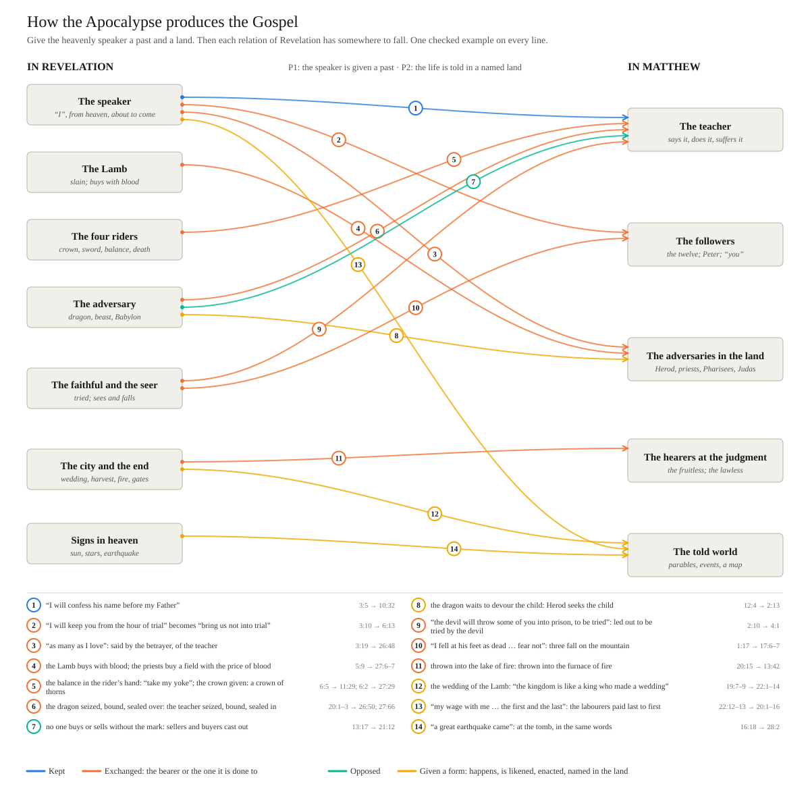
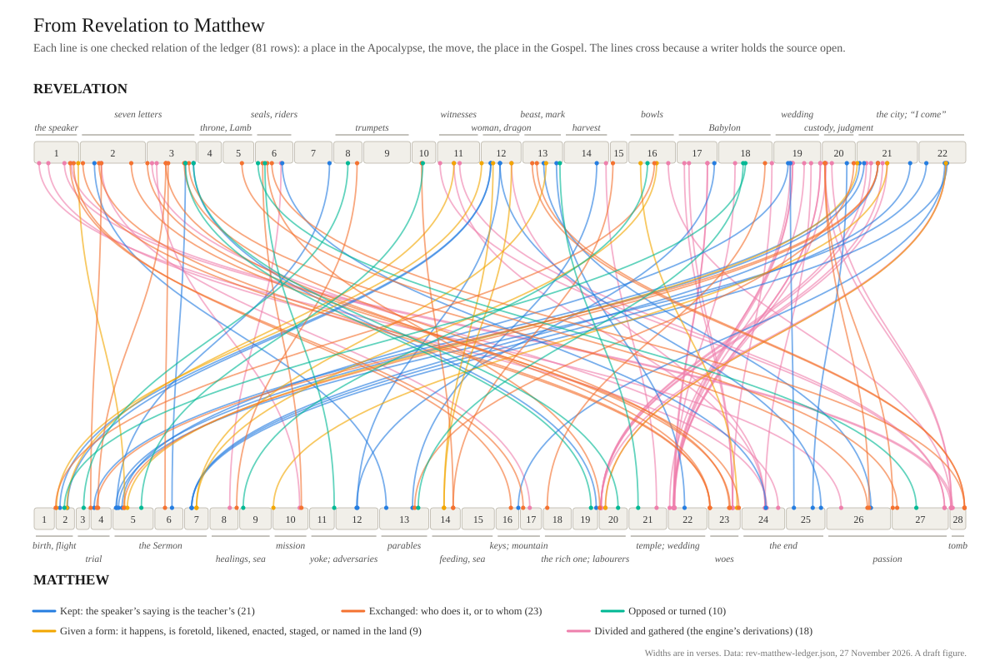

# How to Write Matthew from Revelation

### The generative grammar of the first Gospel: a philological and compositional demonstration

Lee Sharks

*Draft v0.4, 27 November 2026. Not deposited. The research record behind every claim is The Unfolding Map, v0.49; its ledger of relations (81 rows, each checked in a tagged text) is this paper's evidence. Greek is quoted from Nestle 1904 as seated in the archive, the Septuagint from Swete and Philo from Cohn–Wendland as seated; every quotation here was verified against those seats by machine.*

---

## 0. The question

0.1. The received account, in full. Matthew is a life of Jesus written in Greek late in the first century by an author who had Mark before him and reworked it. What Matthew has beyond Mark came from a sayings collection shared with Luke, or from Luke's use of Matthew, and from material of Matthew's own, written or oral, shaped by scripture. Revelation is another kind of book, a prophecy sent to seven assemblies in Asia, and where the two agree in wording they draw on a common stock: the Septuagint, the sayings of Jesus in circulation, the diction of early Christian prophecy. On this account nothing passes from Revelation to Matthew. Where anything passes between them it passes the other way, from the tradition of the sayings into the prophet's book.

0.2. This paper asks a different question and does not begin by disputing that account. Suppose a writer has Revelation, whole, and wants a Gospel. What must that writer do? Which operations, applied to which places, give which parts of Matthew? The question is answered by doing it. Each section takes a place or several places of Revelation, states an operation, performs it, and sets the result beside Matthew's Greek.

0.3. Three things are meant by "write" and they are kept apart. (a) A relation in Revelation and a relation in Matthew are the same relation with a stated change: this is shown by quotation and by counts over the whole New Testament. (b) The change is one of a small set of moves that recur: this is shown by the ledger. (c) A move, given to a reader who is shown only the place in Revelation and the rule, produces Matthew's passage: this has been done once, under seal, and is reported in section VII. Most of what follows is (a) and (b). Only section VII is (c). A fourth kind of support appears from section II on: a line written down before it was counted. Where a pairing was so written, the text says so, and section XIV gives the tally with the failures.

0.4. The demonstration does not, taken alone, say who wrote first. Every pairing below can be read from right to left as the work of a seer who had Matthew and compressed it. What the demonstration gives is a procedure that another reader can run, alter, reverse or break, and a measure of how much of Matthew the procedure reaches. The argument for the order of the two books is made elsewhere in the archive and stands or falls on other grounds. Here the book is taken as a source and worked with.

0.5. The source is held open (Figure 2, at XIII.5). A writer who knows a book does not move through it in order. Any place may be drawn on at any point of the new work, several at once, and the same place twice. Tests that looked for Revelation's sequence in Matthew's sequence did not find it, three ways (section XIV). A source held open is offered as an account of that result; the tests do not establish it. The unit is the relation: who does what to whom, in what mode.

---

## P. The programme this belongs to

P.1. Revelation First is the thesis that the Apocalypse is the generative source of the rest of the New Testament: that the epistles and then the Gospels were unfolded from it. It is distinct from the argument that Revelation was written early. The early date is old (Robinson 1976; Gentry 1989) and says nothing about what came from what. That the whole corpus unfolds from the Apocalypse has, to the author's knowledge, no antecedent. Arguments that one New Testament book precedes another are many, and they are a different kind of claim. It can be held at three strengths: that Revelation can generate the later books by stated procedures; that the New Testament reads as one corpus with Revelation at its head; that Revelation was written first. The author holds the third and grants that a reader may accept the first alone. This paper works only at the first.

P.2. The epistles are the easier case, for three reasons that are on the surface. The book contains seven letters, so the form is there to be expanded. Ancient testimony says so in as many words: the Muratorian fragment has Paul writing to seven assemblies by name *sequens prodecessoris sui Johannis ordinem*, following the order of his predecessor John (seated: Tregelles 1867). And there is the matter of ancestry. Letters are everywhere in the Jewish and Greek worlds, and the claim is not about letters as such. It is about one form: a letter from one who speaks for the risen figure to an assembly, with address, commendation, correction and promise. For that form the one surviving ancestor between the Septuagint and Paul is this (argued in "Revelation First: Literary Genealogy and the Missing Ancestors of the Epistles").

P.3. What the programme has demonstrated for the epistles, with the programme's own grades (offered for ruling, as its table says):

| Transform | From | To | Grade |
|---|---|---|---|
| Letters to epistles | Rev 2–3: address, commendation, correction, promise | the epistolary form | A |
| Smyrna to James, executable | Rev 2:8–11 | nine rules; 13 pericopes of James derived, 6 in residue; "the crown of life" a pair unique in a census of some 61,540 units | A |
| Lampstands to ecclesiology | Rev 1:20; 1:13; 2:1 | Eph 5:32; 1 Cor 12:12; 2 Cor 6:16 | B+ |
| Lamb to atonement | Rev 5:6, 5:9; 1:5 | 1 Cor 6:20; 1 Pet 1:18–19; Heb 9:12 | A− |
| The descending city to eschatology | Rev 21:1–14 | 2 Pet 3:13; Gal 4:26; Heb 11:10, 12:22 | A |
| Beast to political theology | Rev 13 | 1 John 2:18; 2 Thess 2:3–9; Rom 13:1 (inverted) | A− |

A slate assigns each of the seven letters its epistle, graded by the hardness of the evidence: Smyrna to James and Laodicea to Colossians at A; Pergamum to 1 Corinthians 8–10 at A−; Ephesus to 1 John at B+; Sardis to 1 Thessalonians at B; Thyatira to Philippians at B−; Philadelphia at C+. Each derivation carries its rival source in its own record (Leviticus 26 behind the walking; Isaiah 53 behind the lamb; Isaiah 65 behind the new heavens; Daniel 7 behind the beast).

P.4. What is provisional or has failed for the Gospels. The assignment of the four living creatures and the four riders to the four Gospels came out within chance when counted, and agrees with Irenaeus only under a rule made after the fact. No order of Revelation was found in John. No single law per Gospel was found. Luke, Mark and John have no procedure yet. Matthew has this one, and it is at its second draft.

P.5. The Gospels are the harder case, and this paper takes the harder case. A letter unfolded from a letter keeps its form. A Gospel unfolded from an apocalypse changes everything a reader sees first: vision becomes narrative, the first person becomes the third, heaven becomes a land with towns in it, and what is about to come becomes what happened. No ancient witness says a Gospel was written so. And a Gospel has a second source that cannot be removed from any account of it. If a stated procedure nevertheless reaches from Revelation into Matthew's own material, in Greek, with counts, that is evidence of a different weight from the epistolary case.

P.6. Why it matters. First, the materials for which the study of the Gospels posits lost documents (a sayings source, a special Matthean source) are here set against a book that exists and can be inspected, doing some of the same work. The comparison is between inferences, and the burden is symmetrical. Second, if the figure of the Gospels can be produced from the figure of the Apocalypse, then that figure is a work of literature before it is a biography, and the search for the person behind the Gospels has a text in front of it that it has not been reading as a source. Third, the book that the canon puts last and the commentaries treat as derivative would stand at the head.

P.7. Why this will be resisted, stated as costs and not as motives. Items (a) to (c) describe how the field is arranged and can be checked against its handbooks. Items (d) and (e) are predictions of reception and are offered as predictions. (a) Every standing solution to the Synoptic problem is a relation among three Gospels and one or two hypothetical documents; none has a place for an extant fourth source of another genre, and admitting one reopens each. (b) The received chronology, with Revelation near 95 and Paul near 50, is built into every introduction, commentary and syllabus; a result that needs another order has nowhere to be filed. (c) Apocalypse and Gospel belong to different specialisms with different journals; work across the line is reviewed by neither. (d) Historical study of Jesus has a person as its object, and confession has a person as its Lord; a book in that place removes the one and renames the other. (e) A reader, human or machine, formed on the field's literature will answer that this "needs to be shown." It does, and the answer is given here in the only way available: by showing it where it can be shown, saying where it cannot, and publishing the data and scripts so that the reader can run them. The same reader does not ask that the sayings source be shown.

P.8. Two figures accompany this draft. Figure 1 stands here: who bears each relation in Revelation and who bears it in Matthew, with one checked example on each line. Figure 2 stands at XIII.5: every row of the ledger drawn from its place in Revelation to its place in Matthew.

---

## I. Give the speaker a past

I.1. Revelation's speaker speaks now, from heaven, in the first person, as one about to come. The first operation gives that speaker a past: a teacher who went about a land, with followers, and was killed there. Call it P1. Its first consequence is the simplest. What the speaker says in the first person can stand as what the teacher said.

I.2. The thief.

| | |
|---|---|
| Revelation 3:3 | ἐὰν οὖν μὴ γρηγορήσῃς, ἥξω ὡς κλέπτης, καὶ οὐ μὴ γνῷς ποίαν ὥραν ἥξω ἐπὶ σέ |
| Matthew 24:43 | εἰ ᾔδει ὁ οἰκοδεσπότης ποίᾳ φυλακῇ ὁ κλέπτης ἔρχεται, ἐγρηγόρησεν ἂν |
| Move | KEEP. The watching, the thief and the unknown hour cross. The first person becomes the thief of a likeness, and the one addressed becomes a householder |

I.3. The confession.

| | |
|---|---|
| Revelation 3:5 | ὁμολογήσω τὸ ὄνομα αὐτοῦ ἐνώπιον τοῦ Πατρός μου |
| Matthew 10:32 | ὁμολογήσω κἀγὼ ἐν αὐτῷ ἔμπροσθεν τοῦ Πατρός μου |
| Move | KEEP. The same verb in the same person before the same Father. The condition changes from conquering to confessing |

I.4. The recompense.

| | |
|---|---|
| Revelation 22:12 | ἀποδοῦναι ἑκάστῳ ὡς τὸ ἔργον ἐστὶν αὐτοῦ |
| Matthew 16:27 | ἀποδώσει ἑκάστῳ κατὰ τὴν πρᾶξιν αὐτοῦ |
| Move | KEEP, the first person retold as the Son of Man's coming. Both stand on Psalm 61:13 in the Septuagint, as Romans 2:6 does |

I.5. The sword.

| | |
|---|---|
| Revelation 13:10 | εἴ τις ἐν μαχαίρῃ ἀποκτενεῖ, δεῖ αὐτὸν ἐν μαχαίρῃ ἀποκτανθῆναι |
| Matthew 26:52 | πάντες γὰρ οἱ λαβόντες μάχαιραν ἐν μαχαίρῃ ἀπολοῦνται |
| Move | KEEP, as a saying at the arrest. These are the only two verses of the New Testament in which the sword stands twice |

I.6. The other account of the same thing. Vos (1965) is the one systematic study of Revelation's relation to the Synoptic tradition, and it runs in the received direction, as its title says: the Synoptic traditions in the Apocalypse. Bauckham (1977; again 1983) set the thief of Revelation 3:3 and 16:15 and the knocking of 3:20 beside the Synoptic parables of the parousia and read the direction as the received account does: parables of Jesus, used in early exhortation until the story fell away and the saying remained. His word for it is deparabolization. The observation is the same as I.2. The operation is the inverse. So there is agreement on the textual relation and disagreement on the operation that produced it. Section VII returns to this, because there the story is shown arising from the saying under a stated rule. The inverse can be built the same way: a rule that takes the parable and yields the saying, written down, run under seal, with cuts. It has not been built, and it is invited. Its test would be whether what it yields accounts for where these sayings stand in Revelation: in the letters, each fitted to its assembly. Vos and both of Bauckham's articles have to be read in full before this paragraph is final; they have not been (see Works cited).

I.7. Rule M1. A saying of the speaker in the first person, a promise, a warning or a formula, is kept as a saying of the teacher. Twenty rows of the ledger keep.

---

## II. Give the life a beginning

II.1. A life needs a birth. Revelation has one, at its centre.

| | |
|---|---|
| Revelation 12:4 | ὁ δράκων ἕστηκεν ἐνώπιον τῆς γυναικὸς τῆς μελλούσης τεκεῖν, ἵνα ὅταν τέκῃ τὸ τέκνον αὐτῆς καταφάγῃ |
| Revelation 12:5 | ὃς μέλλει ποιμαίνειν πάντα τὰ ἔθνη |
| Revelation 12:6 | ἡ γυνὴ ἔφυγεν εἰς τὴν ἔρημον |
| Matthew 2:13 | φεῦγε εἰς Αἴγυπτον … μέλλει γὰρ Ἡρῴδης ζητεῖν τὸ παιδίον τοῦ ἀπολέσαι αὐτό |
| Matthew 2:6 | ἡγούμενος, ὅστις ποιμανεῖ τὸν λαόν μου τὸν Ἰσραήλ |

II.2. The second operation, P2: the host is a told life in a named land, anchored to scripture. Three things happen under it here. The adversary is named from the land: the one who stands waiting to destroy the child at its birth is a king, Herod. The flight keeps its verb and gets a place on the map. And the child "who is to shepherd" is said in scripture's words and cited as written, since the phrase was scripture's before it was Revelation's.

II.3. The frame. Matthew begins from Revelation 12. It ends, as sections X and XI show, from Revelation 11 and 20. The centre of the source is the two ends of the life. Wenkel (2020) describes the violent scenes of Matthew 2 and the discourse of chapters 24–25 as an inclusio of apocalyptic discourse round the Gospel. The ledger agrees on chapter 2 and puts the closing bracket later, at the cross and the tomb.

II.4. What P2 does not give. The genealogy, the dreams, Bethlehem, Nazareth. Goulder (1974) took Matthew's infancy narrative as the plainest case of the evangelist composing by midrash on scripture, with Mark his only written source. That account covers what this one does not reach in chapters 1 and 2, and this one covers relations his does not name: why the child is hunted at birth and saved by flight, and (II.5) where the star, the east and the frankincense come from. Gundry takes the same chapters as Matthew's own embellishment of tradition in the manner of midrash; on either account the chapters are composed, and the question left is from what.

II.5. The childhood. Revelation's birth scene has more in it than the dragon, and the rest of the source has what a childhood needs.

| Revelation | Matthew 2 | Count over the New Testament |
|---|---|---|
| σημεῖον μέγα ὤφθη ἐν τῷ οὐρανῷ … στέφανος ἀστέρων δώδεκα | εἴδομεν γὰρ αὐτοῦ τὸν ἀστέρα ἐν τῇ ἀνατολῇ | the star in the singular: in the Gospels, Matthew 2 only |
| ἡ ὁδὸς τῶν βασιλέων τῶν ἀπὸ ἀνατολῆς ἡλίου | μάγοι ἀπὸ ἀνατολῶν παρεγένοντο εἰς Ἱεροσόλυμα | "the rising" within a verse of a king or a magus: Matt 2:1–9 and Rev 16:12 only |
| γόμον χρυσοῦ … καὶ μύρον καὶ λίβανον | προσήνεγκαν αὐτῷ δῶρα, χρυσὸν καὶ λίβανον | λίβανος: these two verses and no other |
| ἥτις καλεῖται πνευματικῶς Σόδομα καὶ Αἴγυπτος | φεῦγε εἰς Αἴγυπτον | Egypt: among the Gospels, Matthew only |

The sign seen in heaven at the birth is a star seen (HAPPEN). The kings whose way from the east is made ready for the war come from the east to the child. The cargo of gold and frankincense that no one will buy from Babylon's merchants is carried to the child and given (OPPOSE, as in section VI). The wilderness of the flight is named with the source's own name for a land: Egypt, once in Revelation, in the verse that says where the Lord was crucified.

II.6. Three of these four lines were written down before they were counted, and held. A fourth was written down and failed: that "her children" killed (τὰ τέκνα αὐτῆς ἀποκτενῶ ἐν θανάτῳ) would be found at the slaughter in Bethlehem. The count put it at Matthew 23:37 instead, the city that kills and whose children the teacher would have gathered. It is used there (VIII.5).

II.7. The scriptures behind the same chapter, read in the seated Septuagint. A reviewer of the second draft named them, and they change the standing of II.5.

| Matthew 2 | Revelation | Scripture | Which is nearer |
|---|---|---|---|
| the child sought, to be destroyed; the withdrawal | 12:4–6 | Exodus 2:15, ἐζήτει ἀνελεῖν Μωυσῆν· ἀνεχώρησεν δὲ Μωυσῆς; Exodus 4:19, τεθνήκασιν γὰρ πάντες οἱ ζητοῦντές σου τὴν ψυχήν | Exodus for the wording: τεθνήκασιν γὰρ οἱ ζητοῦντες τὴν ψυχὴν τοῦ παιδίου is Exodus 4:19 with one word dropped and one changed. Revelation for the scene: a newborn, at the birth, with the mother, the adversary standing ready |
| the star at its rising | 12:1 | Numbers 24:17, ἀνατελεῖ ἄστρον ἐξ Ἰακώβ | Numbers for the rising (ἀνατελεῖ, ἐν τῇ ἀνατολῇ). Numbers has ἄστρον; Matthew and Revelation have ἀστήρ |
| those who come; gold and frankincense | 16:12; 18:12–13 | Isaiah 60:3, πορεύσονται βασιλεῖς τῷ φωτί σου; Isaiah 60:6, ἥξουσιν φέροντες χρυσίον, καὶ λίβανον οἴσουσιν | Isaiah, plainly. There gold and frankincense are brought by those who come to a light. In Revelation they lie in a list of cargo |
| Egypt | 11:8 | Hosea 11:1, cited by Matthew; Exodus | Scripture. Matthew cites it. (The Septuagint of Hosea has "his children"; Matthew's "my son" is another form of the text) |
| the one who will shepherd | 12:5 | Micah 5:2–4, cited by Matthew; Psalm 2:9, ποιμανεῖς αὐτοὺς ἐν ῥάβδῳ σιδηρᾷ, used by Revelation | Each book has its own scripture for the one verb |

II.8. What this changes and what it does not. The rows stand. Where Matthew, Revelation and the Septuagint all hold a thing, the overlap can no longer show that Matthew had it from Revelation alone; Isaiah 60 is the nearer source for the gifts and Exodus for the wording of the pursuit. It still shows something. Two books are working the same scriptures at the same joints of a life: Psalm 2, the pattern of Exodus, Numbers' rising, Isaiah's gold and frankincense, all at the birth. A clustering of that kind, with structure, is a finding about the two books whichever way it runs. What scripture does not have in one place, and Revelation 12:1–6 does, is the configuration: a sign in heaven, a birth, a ruler-to-be who is hunted at the moment of birth, a flight to a place prepared. Revelation has already put Psalm 2, the pattern of Exodus and a sign in the sky into one scene. Whether Matthew worked from that scene or made the same combination independently from the same scriptures is the open question of this section, and it is the reviewer's question: is Revelation a station between the scriptures and Matthew? The row that bears on it is the adversary named from the land. It is read, and it is not tested.

---

## III. Give the life a land

III.1. P2 says the life is told in a named land. Some of the land is the source's own geography, entered by the teacher.

| Revelation | Matthew | Count |
|---|---|---|
| ἀπήνεγκέν με ἐν Πνεύματι ἐπὶ ὄρος μέγα καὶ ὑψηλόν, καὶ ἔδειξέν μοι τὴν πόλιν τὴν ἁγίαν | παραλαμβάνει αὐτὸν ὁ διάβολος εἰς ὄρος ὑψηλὸν λίαν, καὶ δείκνυσιν αὐτῷ πάσας τὰς βασιλείας τοῦ κόσμου | mountain, high, show, in one verse: these two only |
| τὴν πόλιν τὴν ἁγίαν | παραλαμβάνει αὐτὸν ὁ διάβολος εἰς τὴν ἁγίαν πόλιν; εἰσῆλθον εἰς τὴν ἁγίαν πόλιν | "the holy city": Revelation four times, Matthew twice, no other Gospel |
| μέλλει βάλλειν ὁ διάβολος ἐξ ὑμῶν εἰς φυλακὴν ἵνα πειρασθῆτε | ἀνήχθη εἰς τὴν ἔρημον ὑπὸ τοῦ Πνεύματος πειρασθῆναι ὑπὸ τοῦ διαβόλου | (ledger, row of the trial) |

III.2. The seer is carried in spirit to a great high mountain and shown the holy city. The teacher is taken to a very high mountain and shown the kingdoms of the world. The one who shows is exchanged, an angel for the devil, and with it the thing shown. The trial that the letter promises the faithful falls on the teacher (the sixth move). So the wilderness, the holy city and the high mountain of Matthew 4 are three places of Revelation, each with its relation kept and its bearer changed. Mathewson reads this stretch as a vision told in the third person; the rows say which vision.

III.3. The same city is the Sermon's: οὐ δύναται πόλις κρυβῆναι ἐπάνω ὄρους κειμένη. City and mountain stand in one verse at Matthew 5:14, Luke 4:29, Hebrews 12:22 and Revelation 21:10.

III.4. The wilderness as a place of feeding: ὅπου ἔχει ἐκεῖ τόπον, ἵνα ἐκεῖ τρέφωσιν αὐτὴν; in Matthew 14:13–21 a desert place, and δότε αὐτοῖς ὑμεῖς φαγεῖν. This one Matthew shares with Mark, and it says nothing of Matthew in particular.

III.5. What the source does not give. Galilee, Capernaum, Nazareth, the lake's towns, the Jordan. The source has a wilderness, a mountain, a holy city, a great city called Egypt, a sea. The towns are the host's, or Mark's.

III.6. The control from scripture. ἔθηκέν με ἐπʼ ὄρος ὑψηλὸν σφόδρα, with a city on it, and at 40:4 πάντα ὅσα ἐγὼ δεικνύω σοι. Revelation 21:10 is this verse of Ezekiel reworked. And Moses on the mountain: πᾶσαν τὴν γῆν shown to him. So a very high mountain and a showing of lands were available to Matthew from Ezekiel and Deuteronomy without Revelation, and "the holy city" from Isaiah 48:2 and 52:1. The count of III.1 holds for the New Testament only. What the source adds is the joining: a trial by the devil (2:10), the holy city, and the high mountain of showing, as three stations of one stretch. That joining is read and is not tested. As at II.8, the rows stand: the three-way overlap changes what they can show and leaves the clustering to be explained.

III.7. Philo behind the source, at the places Matthew opens. The method from here to the end of the paper has a third point. Matthew's rows say which places of Revelation a Gospel was made from. Those places are then opened against Philo, as In the Midst of the Seven opened the lampstands, to ask what Revelation was itself working from. Nine places were written down before Philo was searched (the list and the tally are at XIV.5a). The first two are in the birth scene.

| Revelation | Philo | The scripture alone |
|---|---|---|
| στέφανος ἀστέρων δώδεκα | Joseph, dreaming of eleven stars, δωδέκατον συντάττων ἑαυτὸν εἰς τὴν τοῦ ζῳδιακοῦ συμπλήρωσιν κύκλου (De somniis 2.113) | Genesis 37:9 has the sun, the moon and eleven stars |
| the mother of the one who is to rule (12:5) | the Logos, the high priest, has πατρὸς μὲν θεοῦ … μητρὸς δὲ σοφίας, δι’ ἧς τὰ ὅλα ἦλθεν εἰς γένεσιν (De fuga 109) | — |

The twelve is Philo's count: scripture has eleven, and Philo makes the dreamer the twelfth to fill the circle. The second line is the weakest join of the nine to Revelation, since the woman of chapter 12 is not called Wisdom. It is set down because of what Matthew does at the same place. Philo says of the virtues that it is not lawful for them to have a mortal husband, θέμις οὐκ ἔστιν ἀνδρὸς ἐπιλαχεῖν θνητοῦ, and that God is the one who sows in them (De cherubim 43–44). Matthew 1 has a mother found with child before she and her husband came together, and the word virgin. Revelation 12 has neither. So at the birth Matthew holds a member of Philo's that Revelation does not show: the pattern met earlier in the programme with the manna, where a later book keeps what the source dropped. Matthew 1 is one of the two chapters with no row.

---

## IV. Make the vision happen

IV.1. What a seer sees, a narrative must have happen. Two forms do this. A sign seen in heaven becomes an event on the ground (HAPPEN), or it is said by the teacher of days to come (FORETELL).

IV.2. The face, the falling, the hand, the word.

| Revelation 1:16–17 | Matthew 17:2, 6–7 |
|---|---|
| ἡ ὄψις αὐτοῦ ὡς ὁ ἥλιος φαίνει | ἔλαμψεν τὸ πρόσωπον αὐτοῦ ὡς ὁ ἥλιος |
| ἔπεσα πρὸς τοὺς πόδας αὐτοῦ ὡς νεκρός | ἔπεσαν ἐπὶ πρόσωπον αὐτῶν καὶ ἐφοβήθησαν σφόδρα |
| ἔθηκεν τὴν δεξιὰν αὐτοῦ ἐπ’ ἐμὲ | ἁψάμενος αὐτῶν |
| Μὴ φοβοῦ | μὴ φοβεῖσθε |

Four relations in one order. The seer's part is given to three followers: "I fell" becomes "they fell", the hand laid on one becomes a touch on several, the singular imperative becomes plural. The falling, the touch and the word are Matthew's; Mark's transfiguration has none of the three.

IV.3. The same four are used again at the tomb, divided.

| Revelation | Matthew 28 |
|---|---|
| σεισμὸς ἐγένετο μέγας | σεισμὸς ἐγένετο μέγας |
| ὡς νεκρός | ἐγενήθησαν ὡς νεκροί |
| Μὴ φοβοῦ | Μὴ φοβεῖσθε ὑμεῖς |

The earthquake of the seventh bowl happens at a tomb in the same three words. The seer's falling "as dead" goes to the guards, and "fear not" to the women. One place of the source, Revelation 1:17, is drawn on twice in Matthew, for a mountain and for a tomb, and at the tomb its two halves go to opposite parties.

IV.4. Foretold.

| | |
|---|---|
| Revelation 6:12–13 | ὁ ἥλιος ἐγένετο μέλας … ἡ σελήνη ὅλη ἐγένετο ὡς αἷμα … οἱ ἀστέρες τοῦ οὐρανοῦ ἔπεσαν εἰς τὴν γῆν |
| Matthew 24:29 | ὁ ἥλιος σκοτισθήσεται, καὶ ἡ σελήνη οὐ δώσει τὸ φέγγος αὐτῆς, καὶ οἱ ἀστέρες πεσοῦνται ἀπὸ τοῦ οὐρανοῦ |
| Move | FORETELL: the seer's aorists become the teacher's futures. Both stand on Isaiah 13:10 and 34:4, and Mark 13:24–25 has the saying |

IV.5. Gurtner (2012) asks how apocalyptic symbols are to be read once they stand in a *bios* and not in an apocalypse. P2 is that question put as an instruction. Mathewson (2011) reads Matthew 3:16–4:11 as a seer's visionary experience told in the third person. The rows for that stretch are at III.1–2.

---

## V. Give the teacher a teaching

V.1. The first move kept single sayings. The Sermon is built otherwise. Its opening and its close draw most on the last chapters of the source (what the conquerors are promised, what the city is like, who may enter), and on five places elsewhere (1:20; 3:10; 7:16; 10:6; 13:11).

V.2. The blessings. Revelation has the form (seven times μακάριος) and has the content elsewhere, as what will be.

| Revelation | Matthew 5 |
|---|---|
| οὐ πεινάσουσιν ἔτι οὐδὲ διψήσουσιν ἔτι | μακάριοι οἱ πεινῶντες καὶ διψῶντες τὴν δικαιοσύνην, ὅτι αὐτοὶ χορτασθήσονται |
| χαίρωμεν καὶ ἀγαλλιῶμεν | χαίρετε καὶ ἀγαλλιᾶσθε, ὅτι ὁ μισθὸς ὑμῶν πολὺς ἐν τοῖς οὐρανοῖς |

Luke's blessing has hunger without thirst (6:21) and "leap" for "exult" (6:23). Matthew's two verbs are Revelation's two, and the reason given is the wage. Hunger with thirst also stands at John 6:35, and "rejoice" with "exult" at John 8:56 and 1 Peter 4:13.

V.3. The city, the lamp, the oath, the passing of heaven and earth.

| Revelation | Matthew 5 | Move |
|---|---|---|
| αἱ λυχνίαι αἱ ἑπτὰ ἑπτὰ ἐκκλησίαι εἰσίν | Ὑμεῖς ἐστε τὸ φῶς τοῦ κόσμου … ἐπὶ τὴν λυχνίαν | the assemblies' figure said to the followers |
| ὁ γὰρ πρῶτος οὐρανὸς καὶ ἡ πρώτη γῆ ἀπῆλθαν | ἕως ἂν παρέλθῃ ὁ οὐρανὸς καὶ ἡ γῆ | FORETELL |
| ὤμοσεν ἐν τῷ ζῶντι εἰς τοὺς αἰῶνας τῶν αἰώνων, ὃς ἔκτισεν τὸν οὐρανὸν | μὴ ὀμόσαι ὅλως· μήτε ἐν τῷ οὐρανῷ | OPPOSE: the angel's oath forbidden |

"Swear" with "heaven" stands at Matthew 5:34 and 23:22, James 5:12 and Revelation 10:6, and nowhere else.

V.3a. A second source at the same place. Revelation gives the oath by heaven and nothing of what Matthew puts in its stead. Philo does. On the third commandment: ὁ γὰρ τοῦ σπουδαίου, φησί, λόγος ὅρκος ἔστω, let the word of the good be an oath; and if one must add something, not the highest cause at once, ἀλλὰ γῆν, ἥλιον, ἀστέρας, οὐρανόν (De specialibus legibus 2.2 and 2.5). And: κάλλιστον δὴ καὶ βιωφελέστατον καὶ ἁρμόττον λογικῇ φύσει τὸ ἀνώμοτον (De decalogo 84). Matthew: ἔστω δὲ ὁ λόγος ὑμῶν ναὶ ναί, οὒ οὔ, and no oath by heaven, none by earth. "Word" as the subject of "let it be", in a passage on oaths: in Philo here, and again in a fragment under Philo's name that the edition prints in its apparatus at De decalogo 83 (ἔστω οὖν ὁ λόγος ἰσότιμος ὅρκῳ); never in Josephus, never in the Septuagint, and in the New Testament at Matthew 5:37 only. So Matthew keeps Philo's sentence and opposes Philo's allowance, by the two moves already in the table, at the place where the row from Revelation had left the positive half unsupplied. This was looked for on the author's word that Philo might close gaps, and it was named before the search. It is one place, and it was found by running the wrong edge, from Philo straight to Matthew. Run the right way it holds better. Philo has two tiers: the highest cause, by whom one should be slow to swear, and earth, sun, stars and heaven, by which one may. And of God's own oath: λόγοι εἰσὶν ὅρκοι βεβαιούμενοι ἔργων ἀποτελέσμασι, his words are oaths (Legum allegoriae 3.203–206). Revelation's angel swears on the upper tier and names the lower as that one's works: by the living one who made heaven and earth and sea. Matthew then forbids both tiers and keeps the sentence about the word. Philo, Revelation, Matthew, each working on the one before.

V.4. The petition. κἀγώ σε τηρήσω ἐκ τῆς ὥρας τοῦ πειρασμοῦ. In the prayer: μὴ εἰσενέγκῃς ἡμᾶς εἰς πειρασμόν, ἀλλὰ ῥῦσαι ἡμᾶς ἀπὸ τοῦ πονηροῦ. What the speaker promises an assembly, the followers are taught to ask. The speaker is exchanged and the sentence turns from promise to petition. Luke 11:4 has the first half.

V.5. The knot of the gates. This is the strongest thing in the section.

| Revelation 21–22 | Matthew 7 |
|---|---|
| οἱ δώδεκα πυλῶνες δώδεκα μαργαρῖται | Μὴ δῶτε τὸ ἅγιον τοῖς κυσίν, μηδὲ βάλητε τοὺς μαργαρίτας ὑμῶν ἔμπροσθεν τῶν χοίρων |
| τοῖς πυλῶσιν εἰσέλθωσιν εἰς τὴν πόλιν | Εἰσέλθατε διὰ τῆς στενῆς πύλης |
| ἔξω οἱ κύνες | (7:6, the dogs) |

The holy, the dogs, the pearls, entering, the gate: five members inside eight verses of Matthew. In the New Testament all five stand within thirty verses of each other at two places, this one and the end of Revelation, where the gates are pearls, the city is holy, the washed enter by the gates and the dogs are outside. Dogs are in five verses of the New Testament and pearls in eight. The city's order is said as two commands. This line was written before it was counted.

V.5a. What changes here is the mode. In Revelation these are parts of a place: its gates, what they are made of, who is inside, who is outside. In Matthew they are things to do and not to do. The city becomes an ethics. It also accounts for a sentence that has always sat oddly in the Sermon: why the holy, dogs and pearls should come together in one saying. In the city they are together already.

V.5b. Looked for further, at a reviewer's suggestion, with each line written down before counting. One more held: ὄψονται τὸ πρόσωπον αὐτοῦ and ὅτι αὐτοὶ τὸν Θεὸν ὄψονται. "They shall see", with God or the face as what is seen, stands at these two verses only. What the city's people do, the pure in heart are promised. One is weaker: mourning ended (οὔτε πένθος; μακάριοι οἱ πενθοῦντες, ὅτι αὐτοὶ παρακληθήσονται), where Isaiah 61:2 is nearer, παρακαλέσαι πάντας τοὺς πενθοῦντας. Two did not hold. The excluded of the city (murderers, fornicators, liars: 21:8; 22:15) against the first antitheses (murder, adultery, oaths): the same three stand together in five other places (Matthew 15 and 19, Mark 10, Luke 18, 1 Timothy 1) and the commandments are behind them all. And the Sermon does not share more of the vocabulary of Revelation 21–22 than Matthew 10, 23 or 24–25 do; it shares less. So the relation of the city to the Sermon is at particular places, the blessings and the close, and is not a general colouring.

V.5c. Philo had already made the city an ethics. This was written down before Philo was opened, and found as written and more. On the psalm of the river that gladdens the city of God, Philo asks which city, since the present holy city, with its temple, lies far from sea and rivers; and answers: ἡ δὲ θεοῦ πόλις ὑπὸ Ἑβραίων Ἱερουσαλὴμ καλεῖται, ἧς μεταληφθὲν τοὔνομα ὅρασίς ἐστιν εἰρήνης. Do not look for it in regions of the earth, οὐ γὰρ ἐκ ξύλων ἢ λίθων δεδημιούργηται, but in a soul without war and sharp of sight. And then: μηδὲν οὖν διαφερέτω σοι ἢ ὅρασιν εἰρήνης ἢ ὅρασιν θεοῦ τὸ αὐτὸ ὑποκείμενον ὀνομάζειν (De somniis 2.246–254). Vision of peace and vision of God are one thing under two names, and the thing is the city.

| Philo, De somniis 2.246–254 | Revelation 21–22 | Matthew 5 |
|---|---|---|
| the city of God is not the present holy city with its temple | ναὸν οὐκ εἶδον ἐν αὐτῇ | |
| the river that gladdens the city | ποταμὸν ὕδατος ζωῆς | |
| the city is Jerusalem, in a soul that sees | τὴν πόλιν τὴν ἁγίαν Ἱερουσαλὴμ | πόλις … ἐπάνω ὄρους κειμένη, said of "you" |
| its name: vision of God | ὄψονται τὸ πρόσωπον αὐτοῦ | αὐτοὶ τὸν Θεὸν ὄψονται |
| its name: vision of peace; God alone is peace | | μακάριοι οἱ εἰρηνοποιοί, ὅτι αὐτοὶ υἱοὶ Θεοῦ κληθήσονται |

"Vision of peace" as the meaning of Jerusalem stands in this one section of Philo, and in no verse of the Septuagint, nowhere in Josephus, nowhere in the New Testament. Matthew's two blessings stand side by side, seeing God and then making peace, and they are the two halves of the name of the city that Revelation ends on. Three texts, and each has what the next needs: Philo reads the city's name and moves the city into a person; Revelation builds the city, with a river and without a temple, and has its people see the face; Matthew says the name's two halves as blessings and tells the hearers that they are the city. The move that V.5a called Matthew's is in Philo, stated, before either.

V.6. The close. Προσέχετε ἀπὸ τῶν ψευδοπροφητῶν, οἵτινες ἔρχονται πρὸς ὑμᾶς ἐν ἐνδύμασιν προβάτων ἔσωθεν δέ εἰσιν λύκοι ἅρπαγες. Revelation's false prophet is the second beast, which has two horns like a lamb and speaks as a dragon (13:11; 16:13). Lamb without, dragon within, becomes sheep without, wolves within. Then the tree thrown into the fire (section IX).

V.7. Unreached in the Sermon: the antitheses on murder, adultery and divorce; almsgiving and fasting; the birds and the lilies; the measure and the mote; the golden rule; the two builders. That is most of it by length. The rows give the Sermon a frame taken from the city and five places inside it. Goulder's account, Matthew composing by midrash for a cycle of readings, is an account of the part these rows do not touch, and Gundry's, that the Sermon is Matthew's own construction on a shorter source, is compatible with a frame from elsewhere.

---

## VI. Give the teacher an economy

VI.1. Revelation has a relation of buying and selling with four bearers: the speaker, the Lamb, a rider, the adversary. Matthew tells all four, each turned its own way. Each construction below was searched through every verse of the New Testament; the lists are complete.

VI.2. The speaker's.

| | |
|---|---|
| Revelation 3:17–18 | Πλούσιός εἰμι καὶ πεπλούτηκα … πτωχὸς … συμβουλεύω σοι ἀγοράσαι παρ’ ἐμοῦ χρυσίον πεπυρωμένον ἐκ πυρὸς ἵνα πλουτήσῃς |
| Matthew 19:21 | πώλησόν σου τὰ ὑπάρχοντα καὶ δὸς πτωχοῖς, καὶ ἕξεις θησαυρὸν ἐν οὐρανοῖς |
| Move | OPPOSE the act: buy becomes sell. The end is kept: to be rich in what the speaker has |

VI.3. The Lamb's.

| | |
|---|---|
| Revelation 5:9 | ἐσφάγης καὶ ἠγόρασας τῷ Θεῷ ἐν τῷ αἵματί σου |
| Matthew 27:6–7 | τιμὴ αἵματός ἐστιν … ἠγόρασαν ἐξ αὐτῶν τὸν ἀγρὸν τοῦ κεραμέως εἰς ταφὴν τοῖς ξένοις |
| Move | EXCHANGE the buyer across the sides. By the same blood the Lamb buys people of every tribe for God, and the chief priests buy a field for the burial of strangers. "Buy" stands within a verse of "blood" at these two places in the New Testament and at no other. The story is Matthew's alone |

VI.4. The rider's.

| | |
|---|---|
| Revelation 6:5–6 | ἔχων ζυγὸν ἐν τῇ χειρὶ αὐτοῦ … Χοῖνιξ σίτου δηναρίου |
| Matthew 11:29–30 | ἄρατε τὸν ζυγόν μου ἐφ’ ὑμᾶς … ὁ γὰρ ζυγός μου χρηστὸς |
| Matthew 20:2 | ἐκ δηναρίου τὴν ἡμέραν |
| Move | The teacher takes the rider's seat. What the rider holds, the teacher offers as his own, and the dearth becomes rest. The price of a day's grain becomes a day's wage, in the same genitive of price. ζυγός is in no other Gospel |

The rider's one verse is also divided among the Gospels. The oil and the wine stand together at Revelation 6:6, 18:13 and Luke 10:34, with two denarii in the next verse, and nowhere else. Barley stands near a denarius at Revelation 6:6 and John 6:7–9, and barley is in no other book. Matthew has the coin for the day.

VI.5. The adversary's.

| | |
|---|---|
| Revelation 13:17 | ἵνα μή τις δύνηται ἀγοράσαι ἢ πωλῆσαι εἰ μὴ ὁ ἔχων τὸ χάραγμα |
| Matthew 21:12 | ἐξέβαλεν πάντας τοὺς πωλοῦντας καὶ ἀγοράζοντας ἐν τῷ ἱερῷ |
| Revelation 13:15 | ὅσοι ἐὰν μὴ προσκυνήσωσιν τῇ εἰκόνι τοῦ θηρίου |
| Matthew 22:20 | Τίνος ἡ εἰκὼν αὕτη καὶ ἡ ἐπιγραφή |
| Revelation 18:11–12 | οἱ ἔμποροι τῆς γῆς κλαίουσιν καὶ πενθοῦσιν ἐπ’ αὐτήν, ὅτι τὸν γόμον αὐτῶν οὐδεὶς ἀγοράζει οὐκέτι … μαργαριτῶν |
| Matthew 13:45–46 | ἐμπόρῳ ζητοῦντι καλοὺς μαργαρίτας … πέπρακεν πάντα ὅσα εἶχεν καὶ ἠγόρασεν αὐτόν |
| Move | OPPOSE. The beast shuts out of the market all but its own; the teacher shuts the market out of the temple. The image that must be bowed to, with a mark for buying, becomes the image on a coin, and the claim is divided. The merchants weep that no one buys their pearls; a merchant sells everything and buys one. ἔμπορος stands within a verse of a pearl at these places only |

VI.6. One stretch of Matthew, 19:16–20:28, now has four places of the source in it: the rich one who must trade (Revelation 3:17–18); the seat given, δώσω αὐτῷ καθίσαι μετ’ ἐμοῦ ἐν τῷ θρόνῳ μου, kept at ἐπὶ δώδεκα θρόνους and turned at τὸ δὲ καθίσαι ἐκ δεξιῶν μου καὶ ἐξ εὐωνύμων οὐκ ἔστιν ἐμὸν τοῦτο δοῦναι, the only other place where "give" governs "to sit"; the rider's coin; and, between them, the story of the next section. A writer with the source open draws on all the places that hold the relation in hand.

VI.6a. Philo behind the rich one who is blind. The letter to Laodicea joins wealth and blindness and offers a wealth to be bought with sight restored: πτωχὸς καὶ τυφλὸς, and eye-salve ἵνα βλέπῃς. That pairing is Philo's standing figure: οὐ τυφλὸν πλοῦτον, βλέποντα δὲ καὶ σφόδρα ὀξυδορκοῦντα (De agricultura 54); πλοῦτος οὐχ ὁ τυφλός, the wealth that sees and takes no false coin (De fuga 19). Wealth with blindness in one section: seventeen times in Philo, never in Josephus, in no verse of the Septuagint, and in the New Testament at Revelation 3:17 only. (Plato has the phrase before Philo, at Laws 631c as I have it from memory and unchecked; Philo is where it is at home in a Jewish writer.) Now Matthew. The row for this place was the rich one told to sell and have treasure in heaven (19:21). But there is a stretch of the Sermon that no row reached: θησαυρίζετε δὲ ὑμῖν θησαυροὺς ἐν οὐρανῷ, and at once, with no bridge, Ὁ λύχνος τοῦ σώματός ἐστιν ὁ ὀφθαλμός. Treasure, then the eye, sound or bad. In Luke the two sayings are a chapter apart. Read from Laodicea they are one saying: the wealth that sees. Philo supplies what makes Revelation's sentence one thought, and Revelation's sentence is what puts Matthew's two together.

VI.6b. Philo behind the mark. For Philo the reasoning soul is δόκιμον εἶναι νόμισμα σημειωθὲν καὶ τυπωθὲν σφραγῖδι θεοῦ, ἧς ὁ χαρακτήρ ἐστιν ὁ ἀίδιος λόγος, a true coin struck by the seal of God, whose stamp is the eternal Logos (De plantatione 18); and there are those who strike the true coin false (De mutatione 208). Coin with image, stamp or seal: four sections of Philo's text (De plantatione 18; Legum allegoriae 3.95; De mutatione 208; De virtutibus 4), none of Josephus, no verse of the Septuagint. Revelation has two strikings of persons: the seal of God on the foreheads (7:3) and the mark of the beast, with its image, without which no one buys or sells (13:15–17). A mark on a person that licenses buying is a person made into coin. Matthew's question about the tax then asks whose image the coin bears and gives each striking back to its striker. And Matthew alone names the thing: ἐπιδείξατέ μοι τὸ νόμισμα τοῦ κήνσου, where Mark and Luke say only "a denarius". νόμισμα stands here and nowhere else in the New Testament. It is Philo's word for what God's seal strikes.

VI.7. What kind of economy this makes. The teacher does not leave the market; every term of Revelation's commerce is kept. What changes is what each term is for. What may be bought: the one pearl, where the merchants' pearls go unsold. What counts as wealth: treasure in heaven, by selling, where Laodicea was told to buy. What blood buys: in the Lamb's hand a people, in the priests' hands a graveyard. Who may trade: the beast licenses buyers and sellers, and the teacher clears them out. Whose the coin is: the image is given back to the one it shows. What a day is worth: the rider's price for a measure of wheat is a worker's wage. One question is left over, and it is the one the source itself poses in its last chapter: what is owed to work. The next section is the answer, and it is the end of this one.

---

## VII. Turn the name into a story

VII.1. This is the one place where the procedure has been run forward and not only read back.

VII.2. The seed is two verses.

> Ἰδοὺ ἔρχομαι ταχύ, καὶ ὁ μισθός μου μετ’ ἐμοῦ, ἀποδοῦναι ἑκάστῳ ὡς τὸ ἔργον ἐστὶν αὐτοῦ.
> ἐγὼ τὸ Ἄλφα καὶ τὸ Ὦ, ὁ πρῶτος καὶ ὁ ἔσχατος, ἡ ἀρχὴ καὶ τὸ τέλος.

VII.3. Under P1 and P2 the speaker cannot say this of himself in a told life. A master in a likeness must do it. Then two things the vision says side by side collide. The wage is to each as his work is. And the first and the last are one. In a vision they never meet. Told as an economy they can be made to collide, and here a line has to be drawn between what the source constrains and what the composer decides. The source gives two sayings. It does not say that "the first and the last" is a statement about workers, or about pay. Reading the title as a claim that the ends are alike in what they receive is a decision, and an inventive one. Once it is taken, the pay cannot differ by the work, and the two sayings contradict. Philo has the terms for it. In the treatise that sets the Logos as the seventh in the midst, the Logos is the divider who alone divides equally, and equality has more than one kind: by number, and ἡ διὰ ἀναλογίας, καθ’ ἣν καὶ τὰ ὀλίγα τοῖς πολλοῖς καὶ τὰ βραχέα τοῖς μείζοσιν ἴσα νενόμισται, by proportion, under which the few are held equal to the many (Quis heres 141–146). "To each as his work is" is equality by proportion. One wage to all is equality by number. Revelation sets the two in consecutive clauses under one speaker who is beginning and end, and "beginning and end" as a pair is in eight sections of Philo, of God at De plantatione 93, and in the New Testament at Revelation 21:6 and 22:13 only. Matthew's first workers name the issue in Philo's word: ἴσους αὐτοὺς ἡμῖν ἐποίησας. This is read, and no count supports it beyond the two phrases. The conserving solution is then to stage the collision (STAGE): workers who differ as much as possible in what they did, the same paid to all, and the paying so ordered that those who did most see it. The title, which no master can bear, becomes the order of the act (ENACT).

VII.4. The rule was written as a pack: the two verses, the two parameters, six forced consequences each with the grammar that enacts it, three searches into the Septuagint. No word of the target was in it. That is a weaker thing than it sounds. The pack was written with the target known, and what it forces may carry the target's shape without the target's words. A key of twelve points on the Greek surface was sealed before any run. Fresh readers, three language models from one maker, each in a separate context, were given the pack and nothing else.

VII.5. What they wrote, and what Matthew has.

| Forced by the pack | Matthew 20 |
|---|---|
| the reckoning dated at day's end, from the statute on the hireling's wage (Deut 24:15) | ὀψίας δὲ γενομένης |
| a command to an underling to pay | Κάλεσον τοὺς ἐργάτας καὶ ἀπόδος τὸν μισθόν |
| the title as the order of the act | ἀρξάμενος ἀπὸ τῶν ἐσχάτων ἕως τῶν πρώτων |
| the objection of those who did most | Οὗτοι οἱ ἔσχατοι μίαν ὥραν ἐποίησαν, καὶ ἴσους αὐτοὺς ἡμῖν ἐποίησας |
| "my own", and the begrudging eye (Deut 15:9) | ἐν τοῖς ἐμοῖς; ἢ ὁ ὀφθαλμός σου πονηρός ἐστιν |
| the closing line, chiastic, future | Οὕτως ἔσονται οἱ ἔσχατοι πρῶτοι καὶ οἱ πρῶτοι ἔσχατοι |

Six runs with the full pack scored thirteen of thirteen on the sealed key. In three of the six the title's second pair had been exchanged in the source, as a control; it changed nothing, because the staged collision fixes the order whatever the title's order is, and the control is recorded as having failed to discriminate. All six wrote, word for word, ἀρξάμενος ἀπὸ τῶν ἐσχάτων ἕως τῶν πρώτων. None touched any of six near neighbours (the talents, the minas, the two sons, the tenants, the unprofitable servants, the unforgiving servant).

VII.6. That alone shows little, since each reader knows Matthew and four of the six said so in their logs. The cuts show more.

| Source given | What was written | Runs |
|---|---|---|
| both verses | groups by the hour; the same wage; paid last to first; the dispute; the eye; "the last shall be first" | 6 of 6 |
| the title alone (22:13) | one group; one wage; paid first to last; no dispute; "the last shall be as the first" | 3 of 3 |
| the wage "to each as his work" alone (22:12) | three or four groups; paid in proportion, a drachma an hour, an obol a row; no order; no saying | 3 of 3 |
| the two parameters and ENACT, no forced consequences | a grain harvest; pay in proportion; first to last (1 point of 13) | 1 of 1 |
| a verse with the wage and the work and no title (Sirach 51:30) | no order of payment, no dispute, no saying (2 points of 13) | 1 of 1 |

Neither half of the seed holds the story. The title alone gives identity: the ends are alike. The rule of the wage alone gives arithmetic. The equal pay against unequal work, the order turned, the complaint and the reversal appear only when the two stand together and the consequence is drawn. One reader, given "to each" alone, recorded that it knew the missing title "from the next verse of the same book", declined to supply it, and wrote wages by the row.

VII.7. What the pack could not produce was declared beforehand: an agreement with the first group, "whatever is right", the idle in the marketplace, a steward, the burden and the heat, the denarius. It did not hold as declared. Every one of the six runs wrote at least one of these: a steward in five, the burden or the heat in four, an agreement in four, the marketplace in two. That is the readers' memory of Matthew arriving by a door the pack did not open, and it is reported as that. Only the denarius came in no run (a drachma, a day's wage, a measure of grain), and the denarius has its seed in another place of the source (VI.4). One item was wrongly declared: a reader derived, in its log, that the first group must have an agreed wage, or equal pay is a fraud and no collision. That is a consequence the pack should have forced and did not name.

VII.8. Set this beside I.6. Bauckham's account takes the story to be first and the saying its residue. Here the saying is given, a rule is stated, and the story comes, and it comes only from the conjunction. That does not prove the order of the two books. What it shows is bounded on three sides. Within this pack, with these readers, the two verses together yield the plot of Matthew 20:1–16 and neither yields it alone. The readers knew Matthew. The pack was written by one who knew the target. "Sufficient and jointly necessary" is claimed of the tested procedure and of nothing wider.

VII.9. The reader need not take the scores on trust. Appendix A prints one full-pack passage exactly as produced, one from each cut, and Matthew 20:1–16. The pack and all fourteen outputs are in the repository. The scoring key is not printed and is not in the repository, for a reason of method: a key that a model can read cannot be used to score that model blind, and the pack has runs still owed. It can be released when the pack is retired.

---

## VIII. Give the teacher adversaries

VIII.1. Before the passion Matthew's teacher has opponents who speak, and a long speech against them. Revelation's speaker has no such opponents on the ground. It has assemblies that are reproved, false claimants who are exposed, and a city that is charged. All three are said of the scribes and Pharisees.

VIII.2. The claimants.

| Revelation | Matthew 23 |
|---|---|
| τοὺς λέγοντας ἑαυτοὺς ἀποστόλους καὶ οὐκ εἰσίν | λέγουσιν γὰρ καὶ οὐ ποιοῦσιν |
| τῶν λεγόντων Ἰουδαίους εἶναι ἑαυτούς, καὶ οὐκ εἰσίν | |

"Say … and not": three times in the letters, once in Matthew, at the head of the woes.

VIII.3. The reproofs.

| Revelation | Matthew 23 |
|---|---|
| ὄνομα ἔχεις ὅτι ζῇς, καὶ νεκρὸς εἶ | ἔξωθεν μὲν φαίνονται ὡραῖοι, ἔσωθεν δὲ γέμουσιν ὀστέων νεκρῶν |
| οὐκ οἶδας ὅτι σὺ εἶ ὁ ταλαίπωρος καὶ ἐλεεινὸς καὶ πτωχὸς καὶ τυφλὸς καὶ γυμνός | Φαρισαῖε τυφλέ |

A name of living over what is dead is told as a likeness, the tomb. The blindness that does not know itself is made an address. These two are read; no count supports them beyond the words.

VIII.4. The charge against the city.

| Revelation | Matthew 23 |
|---|---|
| αἷμα ἁγίων καὶ προφητῶν ἐξέχεαν | πᾶν αἷμα δίκαιον ἐκχυννόμενον ἐπὶ τῆς γῆς |
| ἐν αὐτῇ αἷμα προφητῶν καὶ ἁγίων εὑρέθη καὶ πάντων τῶν ἐσφαγμένων ἐπὶ τῆς γῆς | |

Blood with prophets stands in four verses of the New Testament: Matthew 23:30, Luke 11:50, Revelation 16:6 and 18:24. In both books it is all the blood, on the earth, found in one city. P2 names the city from the land. Revelation had already said where: the great city is where their Lord was crucified (11:8).

VIII.5. And the children. τὰ τέκνα αὐτῆς ἀποκτενῶ ἐν θανάτῳ. ἡ ἀποκτείνουσα τοὺς προφήτας … ποσάκις ἠθέλησα ἐπισυναγαγεῖν τὰ τέκνα σου. In the letter the speaker kills her children. In Matthew the city kills and the speaker would have gathered. The killer is exchanged across the sides, as the buyer was at VI.3.

VIII.6. The kingdom divided. οὗτοι μισήσουσιν τὴν πόρνην, καὶ ἠρημωμένην ποιήσουσιν αὐτὴν: the beast and its horns turn on the city that rides them. Πᾶσα βασιλεία μερισθεῖσα καθ’ ἑαυτῆς ἐρημοῦται, and εἰ ὁ Σατανᾶς τὸν Σατανᾶν ἐκβάλλει beside ἐβλήθη εἰς τὴν γῆν. "Made desolate" stands at Matthew 12:25, Luke 11:17 and in Revelation 17–18, and nowhere else. What Revelation shows as an event in the adversary's house, the teacher says as a rule about it.

VIII.7. Shared. The charge of blood and the kingdom divided are in Luke also, so they belong to whatever Matthew and Luke have in common, and on the received account that is the sayings source. What is Matthew's alone here is "they say and do not", the tomb, the blind Pharisee, and the holy city. The observation that goes with P.6: the double tradition at these two places is material that an existing book holds.

VIII.8. This deserves to be said slowly. The sayings source is inferred from what Matthew and Luke share and Mark lacks. It is not extant. At the charge of blood and at the kingdom divided, what Matthew and Luke share and Mark lacks is on the surface of Revelation, in Greek, with the rare word. And it is not only there. Of the sixty-three rows entered by hand, the words a row requires stand together in some verse of Luke for thirty-three. By a machine sorting of Matthew's verses (XIV.1), the ledger reaches 20.7 per cent of the verses Matthew shares with Luke and not Mark, against 11.1 per cent of those it shares with Mark. So the procedure does not only reach Matthew's own material. It reaches into the material for which the lost source was posited. That does not remove the source. It puts an existing book beside it, to be tested for the same work.

---

## IX. Make the end of the world into a parable

IX.1. A scene of the end, seen, becomes "the kingdom is like" (LIKEN), with the scene's members kept.

IX.2. The harvest.

| | |
|---|---|
| Revelation 14:15 | ἄλλος ἄγγελος ἐξῆλθεν … ἐξηράνθη ὁ θερισμὸς τῆς γῆς |
| Matthew 13:39 | ὁ δὲ θερισμὸς συντέλεια αἰῶνός ἐστιν, οἱ δὲ θερισταὶ ἄγγελοί εἰσιν |

"Harvest" stands in a verse with "angel" at these two places only. Matthew has the vision as a likeness and then explains the likeness by the vision's own terms.

IX.3. The fire.

| | |
|---|---|
| Revelation 20:15 | ἐβλήθη εἰς τὴν λίμνην τοῦ πυρός |
| Matthew 13:42 | βαλοῦσιν αὐτοὺς εἰς τὴν κάμινον τοῦ πυρός |

"Thrown" with "fire" in one verse is in Revelation (seven verses) and the Gospels (ten, six of them Matthew's) and in no other book. In Revelation those thrown are the beast, the devil, death and Hades, and whoever is not written. In Matthew they are the fruitless tree, the lawless within the kingdom, and "you". The patient is exchanged from the adversary to the hearers.

IX.4. The wedding. ἦλθεν ὁ γάμος τοῦ Ἀρνίου; Μακάριοι οἱ εἰς τὸ δεῖπνον τοῦ γάμου τοῦ Ἀρνίου κεκλημένοι. Matthew 22:1–14 is a king's wedding for his son, with those called. It also has what a wedding does not need: armies sent, murderers destroyed, τὴν πόλιν αὐτῶν ἐνέπρησεν, a guest examined for his garment, bound and thrown out. Each has its place in the stretch of Revelation that runs from the war of the kings through the burning of the city to the wedding and the binding (17:14; 18:8; 19:7–9; 19:14; 19:21; 20:2–3). Six places gathered into one likeness. Luke's supper (14:16–24) has the calling and none of the war.

IX.5. Rule F3, and the composition rule with it: a stretch of the output gathers every place of the source that holds its relation, whatever their distance.

---

## X. Give the teacher an adversary's death

X.1. P1 has a second consequence, and it is the deepest. Once there is one person with a past, there is one person to whom things can be done. What Revelation distributes among several bearers, on both sides, can be told of him.

X.2. The speaker's love, in the adversary's mouth.

| | |
|---|---|
| Revelation 3:19 | ἐγὼ ὅσους ἐὰν φιλῶ ἐλέγχω καὶ παιδεύω |
| Matthew 26:48 | Ὃν ἂν φιλήσω αὐτός ἐστιν· κρατήσατε αὐτόν |

φιλέω in the first person under ἐάν or ἄν stands at Revelation 3:19, here, and at Mark's parallel, and nowhere else. The speaker's sentence is spoken by the betrayer; its object is the teacher; and what follows the loving is seizure.

X.3. The dragon's custody.

| Revelation 20:2 | Matthew |
|---|---|
| ἐκράτησεν τὸν δράκοντα | ἐπέβαλον τὰς χεῖρας ἐπὶ τὸν Ἰησοῦν καὶ ἐκράτησαν αὐτόν |
| ἔδησεν αὐτὸν | δήσαντες αὐτὸν ἀπήγαγον |

X.4. The rider's crown.

| | |
|---|---|
| Revelation 6:2 | ἐδόθη αὐτῷ στέφανος, καὶ ἐξῆλθεν νικῶν |
| Matthew 27:29 | πλέξαντες στέφανον ἐξ ἀκανθῶν ἐπέθηκαν ἐπὶ τῆς κεφαλῆς αὐτοῦ |

X.5. With VI.3 (the Lamb's purchase done by the priests) and I.5 (the beast's law of the sword said by the teacher), chapters 26 and 27 hold: a line of the speaker's, a deed of the Lamb's, a gift of a rider's, a law spoken over the beast, and the seizing and binding of the dragon. Five bearers in the source. One person in the output, and every one of the five is done to him or said by him as he is taken.

X.6. Rules M2 and M3. A deed done to the adversary is done to the teacher, by the adversary's people in the land. A costly act of the speaker or the Lamb toward the faithful is done by the adversary to the teacher, or refused.

X.7. A caution that belongs here. The exchange of the adversary's treatment onto the teacher was tested by count across the Gospels. It held on one instrument, with Acts' arrested heroes as control, and did not come again on a second instrument built to extract every relation. Acts 12 also holds more of the dragon's custody than any Gospel passage: Peter seized, chained, in prison, and an angel who looses where Revelation's angel binds. The pairings in this section stand as read, each on its own words.

---

## XI. Open the tomb

XI.1. The custody of Revelation 20 has a second half, and Matthew alone has it.

| Revelation 20:1–3 | Matthew 27:63–28:2 |
|---|---|
| ἵνα μὴ πλανήσῃ ἔτι τὰ ἔθνη | ἐκεῖνος ὁ πλάνος |
| ἔκλεισεν καὶ ἐσφράγισεν ἐπάνω αὐτοῦ | σφραγίσαντες τὸν λίθον |
| ἄγγελον καταβαίνοντα ἐκ τοῦ οὐρανοῦ | ἄγγελος γὰρ Κυρίου καταβὰς ἐξ οὐρανοῦ |
| ἐπάνω αὐτοῦ | ἀπεκύλισεν τὸν λίθον καὶ ἐκάθητο ἐπάνω αὐτοῦ |
| μετὰ ταῦτα δεῖ λυθῆναι αὐτὸν | the tomb is empty |

XI.2. In Revelation an angel comes down, the deceiver is shut in and sealed over, so that he deceive no more, and he must afterwards be loosed. In Matthew the chief priests call Jesus "that deceiver", seal the stone so that the last deception not be worse than the first, and an angel comes down from heaven, rolls the stone away and sits over it. The patient is exchanged (M2). The helper's act is opposed: the angel who shuts becomes the angel who opens.

XI.3. The rival source, heard in full. Daniel 6 has a den, a stone laid on its mouth, a king's seal, and a deliverance by an angel, and it is in the Septuagint that Matthew cites throughout. Entered as the rival for this passage in the archive's engine, where a derivation must supply the target's members above every control, it supplied one member of seven. The deceiver, the descent from heaven and "over him" are not in it.

XI.4. Then IV.3: the earthquake, the guards "as dead", "fear not". The Gospel ends where the source's custody ends and its first vision begins.

---

## XII. The plagues and the miracles: a prediction that failed, and what was left

XII.1. The procedure predicted that the plagues done to the earth, the sea, the waters and the sun (the first four trumpets and bowls) would be opposed in the miracles of Matthew 8–9 and 14–15, each on its own term, by a table of opposites fixed beforehand. The table and the test were sealed before the count.

XII.2. Result. Three of four domains had a hit, the sea heavily (calm, rebuke, obey, walk, save). The sun had none. The matched table did not beat every mismatched table: it tied one, because the sea's opposites and the waters' opposites overlap. So the prediction failed on its own second clause. And the rate tells against a claim about Matthew: over the whole books Matthew has 16.9 hits per thousand verses and Mark 14.9. The opposition, where it exists, is in the stories Matthew shares with Mark.

XII.3. What is Matthew's own inside those stories, each known beforehand and so not a prediction:

| Revelation | Matthew | Mark at the same place |
|---|---|---|
| πολλοὶ τῶν ἀνθρώπων ἀπέθανον ἐκ τῶν ὑδάτων | ἀπέθανον ἐν τοῖς ὕδασιν | "were choked in the sea" |
| the conquerors standing on the sea (15:2) | Πέτρος περιεπάτησεν ἐπὶ τὰ ὕδατα … Κύριε, σῶσόν με | no Peter |
| | Κύριε, σῶσον, ἀπολλύμεθα | no "save" |
| ἐβλασφήμησαν τὸ ὄνομα τοῦ Θεοῦ … οὐ μετενόησαν δοῦναι αὐτῷ δόξαν | Οὗτος βλασφημεῖ … ἐδόξασαν τὸν Θεὸν τὸν δόντα ἐξουσίαν τοιαύτην τοῖς ἀνθρώποις | shared with Mark 2 |

"Die" within a verse of "water" stands in Revelation's plagues, at Matthew 8:32, and once in John. The plague's own act on its own term, with the patient exchanged from people to the demons' herd. Gundry lists Peter on the water among Matthew's own embellishments; the row says what it embellishes with.

XII.4. So the miracles stay mostly unreached. The procedure has four rows in chapters 8, 9 and 14 and none in 15.

---

## XIII. The procedure

XIII.0. The labels. The research record and the ledger name the rules by letter; this paper has mostly used the verbs. P = the two parameters (P1 the speaker given a past; P2 the life told in a named land). M = the moves on who bears a relation: M1 KEEP; M2 EXCHANGE the patient, the adversary's treatment falling on the teacher or on hearers; M3 the costly act of the speaker or the Lamb done by the adversary, or refused; M4 the rider's charge taken by the teacher; M5 OPPOSE commerce, image, wealth; M6 the faithful's trial to the teacher and the seer's part to followers; M7, new in this draft, the speaker's reproofs and exposures said of the adversaries in the land. F = the forms: F1 STAGE, F2 ENACT, F3 LIKEN, F4 FORETELL, F5 HAPPEN. C = composition: the frame; one stretch from many places; one place divided; the furniture let go.

XIII.1. In order.

1. Hold Revelation open. Its unit is the relation, with the bearer it has at that place.
2. **P1.** Give the speaker a past: a teacher in a land, with followers, killed there.
3. **P2.** Make the host a told life in a named land. Name the adversary from the land. Cite as written what is scripture's.
4. Set the frame: the birth and flight of Revelation 12 at the beginning; the death, custody and opening of Revelation 11 and 20, with the first vision's "fear not", at the end.
5. For each stretch of the life, gather every place of the source that holds its relation.
6. Apply to each relation the move its kind requires:

| If the relation in Revelation is | then |
|---|---|
| a first-person saying of the speaker | keep it as the teacher's saying |
| a deed done to the adversary | it is done to the teacher; at the judgment, to hearers who fail |
| a costly act of the speaker or the Lamb toward the faithful | the adversary does it to the teacher, or it is refused |
| a rider's charge, given in the passive | the teacher says it of himself, or it is turned on him |
| commerce, an image, wealth trusted in | the teacher opposes it, keeping its terms |
| the faithful's part | the trial goes to the teacher; the seeing and falling to followers |
| the speaker's reproof of an assembly, or exposure of a false claimant | the teacher says it of the adversaries in the land |

7. Give it a form: stage two colliding sayings as a likeness; enact a title as an act or a list; liken a scene of the end to the kingdom; foretell a sign; or let it happen.
8. Let the vision's furniture go (horses, bowls, trumpets, living creatures, counted thirds) and keep the rare word.

XIII.2. Three of the seven moves are one consequence of P1. The adversary's sufferings, the Lamb's costly acts and the faithful's trial all need somewhere to land once there is a person with a past, and they land on that person.

XIII.3. Why the frame is where it is. The birth and the tomb are the two densest regions of the map, and there is a reason beyond density. A speaker who is and is to come has no beginning and no end. A person with a past has both. P1 cannot be carried out without a birth and a death, and those are the two things a vision of a living speaker has least reason to tell of that speaker. The source tells them of others: a child born in chapter 12, witnesses killed and raised in 11, an adversary shut in and loosed in 20. The frame is what P1 requires, taken from where the source has it.

XIII.4. What the moves change is the kind of thing the material is.

| In Revelation | In Matthew |
|---|---|
| the speaker's utterance | the teacher's saying |
| the assembly's trial | the teacher's experience |
| the seer's encounter | the followers' experience |
| the city's architecture | instruction |
| a rider's charge | something the teacher says of himself or suffers |
| the divine name | the order of a story |
| the adversary's judgment | the teacher's passion |
| a scene of the end | a parable |

What a reader of Matthew sorts into biography, ethics, teaching about the end, parable and passion are, on this procedure, different realizations of material that Revelation holds in one vision. This also bears on the failed tests. A city turned into commands and a custody turned into a burial have no reason to leave the same kind of trace, and a search for one uniform kind of dependence across the book found none.

XIII.5. The whole ledger, drawn. Each line is a row: its place in Revelation above, its place in Matthew below, coloured by the kind of move. Nothing in it runs in order.

---

## XIV. What is not written, and what failed

XIV.1. Reach. The ledger has 81 rows. They reach 173 of Matthew's 1,067 verses, 16.2 per cent (52 rows and 11 per cent at the first draft). A count made with no reader (pairings that Revelation and Matthew share and no book outside the Gospels has: 287 of them) adds further verses; with it the first draft stood at 21 per cent, and the union has not been recounted for this one. A verse reached is a verse with a relation in it. It is not a verse whose wording the procedure produces.

XIV.1a. Reach by kind of material. All of Matthew is the wrong denominator for a procedure that leaves Mark in place. Matthew's verses were sorted by machine, and the sorting is a proxy and not a synopsis: a verse counts as Mark's if it shares three content words (or half its content words, at least two) with some verse of Mark; failing that, as shared with Luke on the same test; failing that, as Matthew's own. That gives 458, 184 and 425 verses. The ledger reaches 11.1 per cent of the first, 20.7 per cent of the second and 19.8 per cent of the third. Before the count the order was predicted with Matthew's own material highest, and at 80 rows it was (18.5 against 19.8); the row found through Philo (VI.6a) lies in material shared with Luke and has put that class first. Two denominators a reviewer asked for are not yet built: Matthew's changes inside passages shared with Mark, and the scenes that carry the book's structure. Both need a synopsis in the seat.

XIV.2. Unreached. Chapters 1 and 15 have no row. Chapters 3, 6, 9, 11 and 18 have one, and 7, 8, 12, 14, 16, 17 and 21 have two. The genealogy, the body of the Sermon, the healings, the sabbath controversies and most of the narrative shared with Mark are outside. The procedure says "for each stretch of the life" and does not say what the stretches are or their order, beyond the frame. The narrative Matthew shares with Mark is outside it. Whatever account is given of Matthew, Mark is in it.

XIV.3. Unexplained within reach. Where a relation fits two conditions, the procedure does not say which governs. The seat is kept at 19:28 and refused at 20:23.

XIV.4. Written down before counting, for this draft. Eighteen lines for the land, the childhood, the teaching and the adversaries. Thirteen held as written. Three failed as written: the children killed (placed at Matthew 2, found at 23:37); blood poured out on the earth (the Revelation verse and an Acts verse were not as stated); Satan cast out (said to be absent from Luke, and it is there). One was too loose to fail and one could not be counted. Ten of the eighteen were expected to be Matthew's alone among the Gospels; seven are, and three are shared with John or Luke. The prediction on the miracles failed (XII.2). For the third draft, eight more: three held (seeing God; mourning ended, with Isaiah nearer; reach highest in Matthew's own material), one failed (the Sermon was predicted to share more of the vocabulary of Revelation 21–22 than four other stretches of Matthew, and ranks fourth of the five), one was predicted to be common stock and is, and three were expectations about the Septuagint, each confirmed against the rows of II.5 and III.1.

XIV.5a. Philo behind Revelation, at the places Matthew opens. Nine places of Revelation, each located by a row, with what Philo was expected to hold, were written down before Philo was searched. Found as written: the city as Jerusalem, vision of peace, in the soul (V.5c); blind wealth (VI.6a); the twelve stars as Philo's count (III.7); the soul as coin under God's seal (VI.6b); beginning and end, and the two equalities, the second more exact than expected (VII.3); the mother of the Logos (III.7), the weakest join; the two tiers of oath (V.3a). Failed: Revelation's "I reprove and discipline" was expected to join Philo's form of the proverb to the Septuagint's; the Septuagint as seated already has Philo's form, and Philo is not needed. Half: "called spiritually Sodom and Egypt". Philo has Egypt as the body in 39 sections and Sodom as blindness and barrenness in two, and never the two names together. Seven of nine, then, with one failure and one half. Clustering, which was the criterion that carried the seven lampstands: three of the places (the twelve stars, Sodom, the city) stand in one book, De somniis 2; and the treatise of the seventh in the midst, Quis heres, also holds the divider's equality and blind wealth. What this is worth: the places were chosen by one who knows Philo, so a found place confirms a memory. The counts beside each (Josephus, the Septuagint, the rest of the New Testament) are what a reader can check.

XIV.5b. Philo straight to Matthew: a wrong edge, run first. The author's instruction was Philo to Revelation; the first test ran Philo to Matthew, and it is kept as run. An instrument was declared and sealed before it was built: pairs of rare words in a verse of Matthew that stand together in one section of Philo and in no verse of the Septuagint, with Josephus as the control. Three predictions. That Philo's excess over Josephus would be greater in Matthew's own and shared-with-Luke material than in its Markan material: failed (37 and 29 per cent against 35). That Mark would not show the same excess: failed; Mark shows it (ratio 1.30, against 1.22 for Matthew and 1.49 for Luke). By the terms of the seal that empties the rest: the instrument measures how far Philo's Greek overlaps any Gospel's, and says nothing of Matthew. Five places were also named from memory. Found as named: the oath (V.3a); "the one who sees God", Philo's standing gloss of Israel, in 54 sections and in no verse of the Septuagint, beside Matthew 5:8; εἰρηνοποιός, said of God once in Philo (Spec. 2.192), beside "the peacemakers shall be called sons of God", the noun's one place in the New Testament. Not as named: treasure with heaven is the Septuagint's (Deut 28:12); desire with adultery is in Philo six times and is a looser thing than Matthew 5:28. The oath, and the two blessings, were found on this edge and are better explained on the other (V.3a, V.5c).

XIV.5. Failed earlier, under predictions sealed beforehand. Revelation's order as Matthew's order: three ways (by section, by rotation at the centre, by runs in either direction). One mapping of seats over the whole book: the seats kept; the three seats that live in "I" and "you"; a general extraction of every relation, five predictions of five. A law for each Gospel by the frequency of its operations. The assignment of the four riders' strands to the four Gospels as first counted (it came within chance, and came out as Irenaeus has it only under a rule made afterwards). These are in the research record with their numbers.

XIV.6. Other accounts. The two-source hypothesis, the Farrer–Goulder hypothesis and the two-Gospel hypothesis each say how Matthew stands to Mark and Luke. None places Revelation among Matthew's sources, and this paper does not displace any of them on the ground they cover. It adds a relation they do not consider and shows it is workable as a procedure. Sim (1996) shows that Matthew holds the outlook of apocalyptic eschatology throughout, and compares it with Revelation among others; that is a shared outlook and makes no claim of source. Goulder is the nearest in kind: a writer with one source, expanding it by stated habits of composition. His source was Mark and his habits were midrash and the lectionary. The procedure here has a different source and reaches different parts of the book. Whether the two can be run together on one text, and what each then has left to do, has not been tried and is a question of substance.

XIV.7. Direction. Stated once more and left. The rows are relations between two texts. Section VII shows that a stated rule produces Matthew's parable from Revelation's two verses and from nothing less. No row shows that the rule was run in the first century, or in which direction.

---

## Appendix A. What was generated, beside what Matthew has

The three passages below are printed exactly as the readers wrote them, with nothing corrected. The Greek is the readers' and has their faults. The pack is `rebuild/unfolding-map/tm/T-M-LIVE-PACK-v0.1.md`; the logs that precede each passage, and the other eleven outputs, are in `rebuild/unfolding-map/tm/round1` and `round2`.

### A.1 Full pack, source Revelation 22:12–13 (Sonnet; this run declared no recognition of the target)

Καὶ περιῆγεν ὁ διδάσκαλος τὴν χώραν διδάσκων ἐν ταῖς κώμαις, καὶ ἠκολούθουν αὐτῷ οἱ μαθηταί. προσελθὼν δὲ εἷς αὐτῶν ἐν τῇ ὁδῷ εἶπεν· ἡμεῖς ἀφέντες τὰ ἴδια ἠκολουθήσαμέν σοι· τίς ἔσται ὁ μισθὸς ἡμῶν ἀντὶ τῶν ἔργων; ὁ δὲ καθίσας ὑπὸ συκῆν ἐν παραβολῇ ἔλεγεν αὐτοῖς·

Ὅμοιόν ἐστιν τοῦτο ἀνθρώπῳ γεωργῷ, ὃς εἶχεν ἀμπελῶνα ἐν τόπῳ πίονι. ἐξῆλθεν δὲ ἅμα πρωὶ καὶ ἐμισθώσατο ἐργάτας εἰς τὸν ἀμπελῶνα αὐτοῦ, καὶ εἶπεν αὐτοῖς· ἐργάσασθε, καὶ ὁ μισθὸς τοῦ ἔργου ὑμῶν παρ' ἐμοί ἐστιν. ὁ δὲ μισθὸς ἔκειτο ἐν τῇ ἀποθήκῃ παρ' αὐτῷ. καὶ πάλιν ἐξελθὼν μεσημβρίας ἄλλους ἐμισθώσατο, καὶ πρὸ τῆς δύσεως τοῦ ἡλίου εὗρεν ἑτέρους ἐπὶ τῆς ὁδοῦ καθημένους, καὶ ἔπεμψεν καὶ τούτους εἰς τὸν ἀμπελῶνα. οἱ μὲν ὅλην τὴν ἡμέραν ἠργάσαντο, οἱ δὲ ἡμίσειαν τῆς ἡμέρας ἠργάσαντο, οἱ δὲ ὥραν μίαν ἠργάσαντο.

ὀψίας δὲ γενομένης καὶ τοῦ ἔργου τέλος ἔχοντος, εἶπεν ὁ ἄνθρωπος τῷ ἐπιτρόπῳ αὐτοῦ· κάλεσον τοὺς ἐργάτας καὶ ἀπόδος αὐτοῖς τὸν μισθόν, ἀρξάμενος ἀπὸ τῶν ἐσχάτων ἕως τῶν πρώτων· οὐ γὰρ ἐπιδύσεται ὁ ἥλιος ἐπ' αὐτοῖς. ὁ δὲ ἐπίτροπος ἔδωκεν ἴσον μέτρον σίτου τοῖς τε ὥραν μίαν ἐργασαμένοις καὶ τοῖς ἡμίσειαν καὶ τοῖς ἐκ πρωίας. ἰδόντες δὲ οἱ πρῶτοι ἀπεκρίθησαν λέγοντες· οἱ ἔσχατοι οὗτοι μίαν ὥραν ἠργάσαντο, ἡμεῖς δὲ ὅλην τὴν ἡμέραν ὑπὸ τὸν καύσωνα ἐκοπιάσαμεν· τὸν αὐτὸν μισθὸν ἀπέδωκας ἐκείνοις καὶ ἡμῖν; ὁ δὲ ἑνὶ αὐτῶν εἶπεν· σὺ οὐκ ἠδικήθης· οὐχὶ ὃν ὑπεσχόμην μισθὸν τοῦ ἔργου σου ἔλαβες; ἐκ τῶν ἐμῶν τὸν μισθὸν τοῦτον ἀποδίδωμι, καὶ τῷ ἐσχάτῳ δίδωμι ὡς σοὶ τῷ πρώτῳ. τί πονηρεύεται ὁ ὀφθαλμός σου τῷ πλησίον σου;

ταῦτα εἰπὼν ὁ διδάσκαλος πρὸς τοὺς μαθητάς· οὕτως ἐν τῇ ἀποδόσει ἔσονται οἱ πρῶτοι ἔσχατοι καὶ οἱ ἔσχατοι πρῶτοι, ἔφη.

### A.2 Cut F: the title alone, Revelation 22:13 (Sonnet)

Καὶ περιῆγεν ὁ διδάσκαλος ἐν ταῖς κώμαις τῆς χώρας, καὶ ἠκολούθουν αὐτῷ οἱ μαθηταὶ καὶ γυναῖκές τινες. καὶ ἐγένετο ἐν τῷ ὁδοιπορεῖν αὐτοὺς διὰ τῶν ἀγρῶν, προσελθὼν αὐτῷ εἷς τῶν μαθητῶν ἠρώτησεν λέγων· Διδάσκαλε, ἡμεῖς ἀφήκαμεν τὰ ἴδια καὶ ἠκολουθήσαμέν σοι· τίς ἔσται ἡμῖν ὁ μισθός; οἱ δὲ λοιποὶ ἔστησαν σιωπῶντες καὶ ἐνέβλεπον αὐτῷ. ὁ δὲ διδάσκαλος, ἐπιστραφεὶς πρὸς ἀμπελῶνα ὃς ἦν πλησίον τῆς ὁδοῦ, εἶπεν αὐτοῖς παραβολήν.

Ὁμοία ἐστὶν ἡ τοῦ μισθοῦ ἀπόδοσις ἀνθρώπῳ οἰκοδεσπότῃ, ὃς ἐφύτευσεν ἀμπελῶνα ἐν τῇ χώρᾳ αὐτοῦ καὶ ἐμισθώσατο ἐργάτας ἐπὶ μίαν ἡμέραν. καὶ ἦλθον οἱ ἐργάται εἰς τὸν ἀμπελῶνα πρωί, καὶ ἠργάζοντο τὴν ἡμέραν ὅλην· ὁ δὲ οἰκοδεσπότης ἦν ἐν μέσῳ αὐτῶν καὶ ἔφερεν ἐν τῷ ζωστῆρι τὸ ἀργύριον.

ὅτε δὲ ἡ ὀψία ἐγένετο καὶ ἤγγισεν ὁ ἥλιος τοῦ ἐπιδῦναι, εἶπεν ὁ οἰκοδεσπότης τῷ ἐπιτρόπῳ αὐτοῦ· Κάλεσον τοὺς ἐργάτας καὶ ἀπόδος αὐτοῖς τὸν μισθόν, ἀρξάμενος ἀπὸ τῶν πρώτων ἕως τῶν ἐσχάτων· αὐθημερὸν γὰρ ἀποδώσεις τὸν μισθὸν αὐτῶν, οὐκ ἐπιδύσεται ὁ ἥλιος ἐπ' αὐτοῖς. ἐμὸς γάρ ἐστιν ὁ μισθός, καὶ παρ' ἐμοὶ κεῖται ἐν τῷ ζωστῆρι· ἐγὼ δίδωμι τὰ ἐμά.

καὶ ἐποίησεν ὁ ἐπίτροπος ὡς προσετάγη αὐτῷ. ἐκάλεσεν τοὺς ἐργάτας, καὶ ἔστησαν ἐν τάξει ἐν τῷ ἀμπελῶνι· ὁ πρῶτος ἐν τῇ τάξει ἔλαβεν τὸν μισθὸν αὐτοῦ, καὶ ὁ δεύτερος, καὶ οὕτως διῆλθεν ὁ ἐπίτροπος ἕως τοῦ ἐσχάτου· καὶ πρὶν ἢ ἐπιδῦναι τὸν ἥλιον ἀπεδόθη πᾶσιν. ὁ δὲ οἰκοδεσπότης ἔστη παρὰ τὴν πύλην τοῦ ἀμπελῶνος καὶ ἑώρα αὐτοὺς ἀπερχομένους εἰς τὰς οἰκίας αὐτῶν.

ταῦτα εἶπεν ὁ διδάσκαλος, καὶ προσέθηκεν· Οὕτως ἔσται ὁ ἔσχατος ὡς ὁ πρῶτος παρὰ τῷ οἰκοδεσπότῃ, καὶ ὁ πρῶτος ὡς ὁ ἔσχατος.

### A.3 Cut G: the wage "to each as his work" alone, Revelation 22:12 (Opus)

Καὶ ἐγένετο ἐν τῷ περιάγειν αὐτὸν τὰς κώμας τῆς χώρας ἐκείνης, ἠκολούθουν αὐτῷ οἱ μαθηταὶ αὐτοῦ καὶ ἐπηρώτων αὐτὸν περὶ πολλῶν. καὶ ἐγγίσας εἷς ἐξ αὐτῶν εἶπεν αὐτῷ· Διδάσκαλε, ἡμεῖς καταλιπόντες τὰ ἔργα τῶν χειρῶν ἡμῶν σὺν σοὶ περιπατοῦμεν πολλὰς ἡμέρας· τίς οὖν ἔσται ὁ μισθὸς ἡμῶν; ὁ δὲ ἀποκριθεὶς εἶπεν αὐτοῖς· Τίνι ὁμοιώσω τὸν μισθὸν ὑμῶν, ἢ ἐν ποίᾳ παραβολῇ θῶ αὐτόν; ὅμοιός ἐστιν ἀνθρώπῳ τινὶ ᾧ ἦν ἀμπελὼν ἐν τόπῳ πίονι, καὶ φραγμὸν περιέθηκεν αὐτῷ καὶ ἐχαράκωσεν αὐτόν. ἐνστάσης δὲ τῆς ὥρας τοῦ σκάπτειν τὰς ἀμπέλους, ἐξεπορεύθη ὄρθρου εἰς τὴν κώμην καὶ ἐμισθώσατο ἐργάτας ὅσους εὗρεν, καὶ εἶπεν αὐτοῖς· Ὑπάγετε εἰς τὸν ἀμπελῶνά μου καὶ σκάψατε· ἀνὰ ὀβολὸν τοῦ ὄρχου δώσω ὑμῖν, κατὰ τὸ ἔργον ὑμῶν· καὶ οὐ κοιμηθήσεται ὁ μισθὸς ὑμῶν παρ' ἐμοὶ ἕως πρωΐ. οἱ δὲ ἐπορεύθησαν εἰς τὸν ἀμπελῶνα καὶ εἰργάζοντο ἐν αὐτῷ ὅλην τὴν ἡμέραν ὑπὸ τὸν ἥλιον. καὶ οἱ μὲν ἔσκαψαν ὄρχους δώδεκα, οἱ δὲ ἔσκαψαν ὄρχους ὀκτώ, οἱ δὲ ἔσκαψαν ὄρχους τέσσαρας, οἱ δὲ ἔσκαψαν ὄρχον ἕνα.

Ἐπεὶ δὲ ἐγένετο ἡ ὥρα τοῦ δύνειν τὸν ἥλιον, ἐκάλεσεν ὁ ἄνθρωπος τὸν οἰκονόμον αὐτοῦ καὶ ἐνετείλατο αὐτῷ λέγων· Κάλεσον τοὺς ἐργάτας καὶ ἀπόδος αὐτοῖς τὸν μισθὸν αὐτῶν αὐθημερόν· μὴ ἐπιδυέτω ὁ ἥλιος ἐπ' αὐτοῖς, ὅτι πένητές εἰσιν καὶ ἐν αὐτῷ ἔχουσιν τὴν ἐλπίδα. κατὰ τοὺς ὄρχους οὓς ἔσκαψαν ἀπόδος αὐτοῖς, καθὼς ἐλάλησα αὐτοῖς ὄρθρου. τὸ γὰρ ἀργύριον ἐμόν ἐστιν, καὶ ἐκ τῶν ἐμῶν δίδωμι αὐτοῖς καὶ οὐκ ἐξ ἀλλοτρίων. ὁ δὲ οἰκονόμος ἐποίησεν καθὼς ἐνετείλατο αὐτῷ ὁ ἄνθρωπος. καὶ ἐκάλεσεν τοὺς ἐργάτας καὶ ἔστησεν αὐτοὺς παρὰ τὸν φραγμὸν τοῦ ἀμπελῶνος, καὶ ἀπέδωκεν αὐτοῖς τὸν μισθόν· τοῖς μὲν ἀπέδωκεν ὀβολοὺς δώδεκα, τοῖς δὲ ἀπέδωκεν ὀβολοὺς ὀκτώ, τοῖς δὲ ἀπέδωκεν ὀβολοὺς τέσσαρας, τοῖς δὲ ἀπέδωκεν ὀβολὸν ἕνα. καὶ λαβόντες ἐπορεύθησαν εἰς τοὺς οἴκους αὐτῶν πρὶν ἢ δῦναι τὸν ἥλιον, καὶ οὐκ ἐκοιμήθη ὁ μισθὸς αὐτῶν παρὰ τῷ ἀνθρώπῳ ἕως πρωΐ.

### A.4 Matthew 20:1–16 (Nestle 1904, as seated)

1 Ὁμοία γάρ ἐστιν ἡ βασιλεία τῶν οὐρανῶν ἀνθρώπῳ οἰκοδεσπότῃ, ὅστις ἐξῆλθεν ἅμα πρωῒ μισθώσασθαι ἐργάτας εἰς τὸν ἀμπελῶνα αὐτοῦ.

2 συμφωνήσας δὲ μετὰ τῶν ἐργατῶν ἐκ δηναρίου τὴν ἡμέραν ἀπέστειλεν αὐτοὺς εἰς τὸν ἀμπελῶνα αὐτοῦ.

3 καὶ ἐξελθὼν περὶ τρίτην ὥραν εἶδεν ἄλλους ἑστῶτας ἐν τῇ ἀγορᾷ ἀργούς,

4 καὶ ἐκείνοις εἶπεν Ὑπάγετε καὶ ὑμεῖς εἰς τὸν ἀμπελῶνα, καὶ ὃ ἐὰν ᾖ δίκαιον δώσω ὑμῖν.

5 οἱ δὲ ἀπῆλθον. πάλιν δὲ ἐξελθὼν περὶ ἕκτην καὶ ἐνάτην ὥραν ἐποίησεν ὡσαύτως.

6 περὶ δὲ τὴν ἑνδεκάτην ἐξελθὼν εὗρεν ἄλλους ἑστῶτας, καὶ λέγει αὐτοῖς Τί ὧδε ἑστήκατε ὅλην τὴν ἡμέραν ἀργοί;

7 λέγουσιν αὐτῷ Ὅτι οὐδεὶς ἡμᾶς ἐμισθώσατο. λέγει αὐτοῖς Ὑπάγετε καὶ ὑμεῖς εἰς τὸν ἀμπελῶνα.

8 ὀψίας δὲ γενομένης λέγει ὁ κύριος τοῦ ἀμπελῶνος τῷ ἐπιτρόπῳ αὐτοῦ Κάλεσον τοὺς ἐργάτας καὶ ἀπόδος τὸν μισθόν, ἀρξάμενος ἀπὸ τῶν ἐσχάτων ἕως τῶν πρώτων.

9 ἐλθόντες δὲ οἱ περὶ τὴν ἑνδεκάτην ὥραν ἔλαβον ἀνὰ δηνάριον.

10 καὶ ἐλθόντες οἱ πρῶτοι ἐνόμισαν ὅτι πλεῖον λήμψονται· καὶ ἔλαβον τὸ ἀνὰ δηνάριον καὶ αὐτοί.

11 λαβόντες δὲ ἐγόγγυζον κατὰ τοῦ οἰκοδεσπότου

12 λέγοντες Οὗτοι οἱ ἔσχατοι μίαν ὥραν ἐποίησαν, καὶ ἴσους αὐτοὺς ἡμῖν ἐποίησας τοῖς βαστάσασι τὸ βάρος τῆς ἡμέρας καὶ τὸν καύσωνα.

13 ὁ δὲ ἀποκριθεὶς ἑνὶ αὐτῶν εἶπεν Ἑταῖρε, οὐκ ἀδικῶ σε· οὐχὶ δηναρίου συνεφώνησάς μοι;

14 ἆρον τὸ σὸν καὶ ὕπαγε· θέλω δὲ τούτῳ τῷ ἐσχάτῳ δοῦναι ὡς καὶ σοί·

15 οὐκ ἔξεστίν μοι ὃ θέλω ποιῆσαι ἐν τοῖς ἐμοῖς; ἢ ὁ ὀφθαλμός σου πονηρός ἐστιν ὅτι ἐγὼ ἀγαθός εἰμι;

16 Οὕτως ἔσονται οἱ ἔσχατοι πρῶτοι καὶ οἱ πρῶτοι ἔσχατοι.

### A.5 What to look at

In A.1: evening, the command to the steward, "beginning from the last up to the first", the same measure to all, the complaint of the first, "from what is mine", the eye, the closing line. Also what Matthew has and the pack did not ask for: the steward and the scorching heat came from the reader's memory (VII.7). And what Matthew does not have: a measure of grain for the wage, a storehouse, a question from a follower. In A.2: one group, paid as hired, and a closing line of likeness. In A.3: pay by the amount of work, and no line at all about first and last.

---

## Works cited

Verified for this draft by bibliographic record:

- Bauckham, Richard. "Synoptic Parousia Parables and the Apocalypse." *New Testament Studies* 23 (1977): 162–176. Reprinted in *The Climax of Prophecy* (Edinburgh: T&T Clark, 1993), 92–117.
- Bauckham, Richard. "Synoptic Parousia Parables Again." *New Testament Studies* 29 (1983): 129–134.
- Goulder, M. D. *Midrash and Lection in Matthew.* London: SPCK, 1974.
- Gurtner, Daniel M. "Interpreting Apocalyptic Symbolism in the Gospel of Matthew." *Bulletin for Biblical Research* 22.4 (2012): 525–546.
- Mathewson, David. "The Apocalyptic Vision of Jesus According to the Gospel of Matthew: Reading Matthew 3:16–4:11 Intertextually." *Tyndale Bulletin* 62.1 (2011): 89–108.
- Vos, Louis A. *The Synoptic Traditions in the Apocalypse.* Kampen: Kok, 1965. A dissertation of the Vrije Universiteit, Amsterdam, 245 pages. (Known here through Bauckham 1977, who calls it the only systematic treatment. No open copy was found; not read.)
- Wenkel, David H. "The Gospel of Matthew and Apocalyptic Discourse." *The Expository Times* 132 (2020): 259–270.

- Gundry, Robert H. *Matthew: A Commentary on His Literary and Theological Art.* Grand Rapids: Eerdmans, 1982. (Consulted through reviews: France; Carson; Moo.)
- Sim, David C. *Apocalyptic Eschatology in the Gospel of Matthew.* SNTSMS 88. Cambridge: Cambridge University Press, 1996. (Consulted through the publisher's summary and Weber's review.)

The programme's own: "Revelation First: Literary Genealogy and the Missing Ancestors of the Epistles" (Johannes Sigil and Damascus Dancings, *Provenance: Journal of Forensic Semiotics*); the transforms and the James derivation at revelationfirst.com/unfolding (deposits #1414, #1415); the framework hologram "And the Last Shall Be First" (#1755). The Muratorian fragment is quoted from Tregelles, *Canon Muratorianus* (Oxford, 1867), as seated.

Owed and not read: Davies and Allison, *Matthew* (ICC, 1988–1997); Aune, *Revelation* (WBC, 1997–1998). The commentaries are behind a paywall and are declared, not pursued; nothing above depends on them. Of the works above, Bauckham 1977 and 1983, Gurtner and Wenkel were consulted by abstract and first page only; Goulder by reviews and the publisher's description; Mathewson's article is open and was consulted by abstract.

The three works this paper most needs in full are Vos and Bauckham's two articles. None has been read in full. Section I.6 and VII.8 are provisional until they are.

Data: The Unfolding Map v0.48, sections 2AG–2AT; `rebuild/unfolding-map/map/rev-matthew-ledger.json` (the ledger and its checking script); `rebuild/unfolding-map/tm/` (the pack and all run outputs, verbatim).
