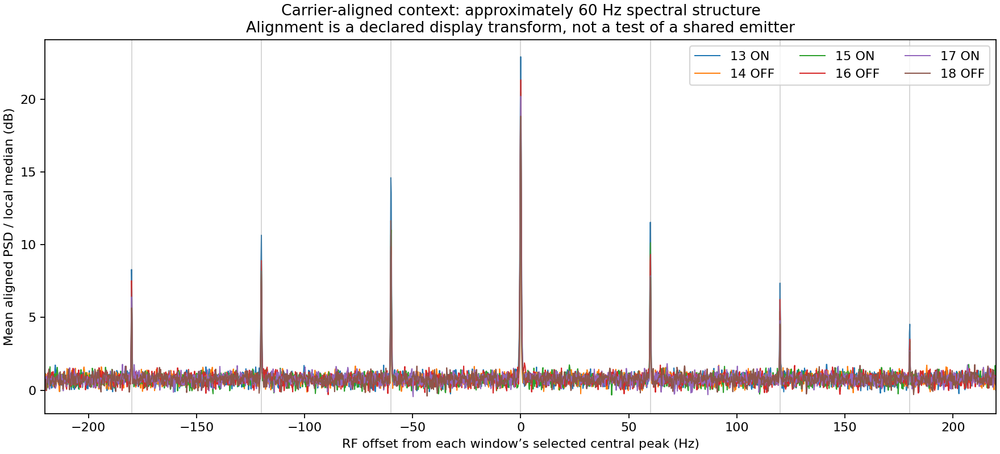

# The Human on the Sheet — the retained complex over time

Lee Sharks · 2026-11-19 · private working analysis · follow-up to the first receiver-side reading

## What the longer record establishes

The known complex near **1665.615120 MHz** remains visible throughout the analyzed portions of all six saved scans, ON and OFF. Its carrier wanders slowly. Companion spectral peaks lie near **60, 120 and 180 Hz offsets** from it. The frequency path differs substantially from the saved comet Doppler prediction. The sender and physical coupling mechanism remain unidentified.

This extends six 6.085-second excerpts to six saved receiver projections of **299.931883 seconds each**. The short-time analysis covers the first **297.784399 seconds** of each input; the unused tail is **2.147484 seconds**. No new source bytes were downloaded. These are narrow projections around the previously selected interference complex, not full-band scans of Earth's emissions.

## Measured carrier path

| Scan | Pointing | Median peak RF (MHz) | Median peak / local median (dB) | Measured slope (Hz/s) | Comet slope (Hz/s) |
|---|---|---:|---:|---:|---:|
| 13 | ON | 1665.615119564 | 22.80 | +0.0455 | -0.1093 |
| 14 | OFF | 1665.615120088 | 15.95 | +0.0132 | -0.1127 |
| 15 | ON | 1665.615120262 | 20.38 | -0.0152 | -0.1161 |
| 16 | OFF | 1665.615120437 | 21.48 | -0.0364 | -0.1195 |
| 17 | ON | 1665.615122532 | 20.04 | -0.0325 | -0.1229 |
| 18 | OFF | 1665.615123929 | 18.52 | -0.0154 | -0.1263 |

Every scan supplies 103 overlapping 5.7266-second windows with a 2.8633-second hop. The selected peak in each of the **618 windows** exceeds the fixed descriptive ratio of 6 against its local spectral median. These windows are correlated through overlap and are not 618 independent detections. The region was selected around a known feature; selecting a maximum also increases its value. The cut is not a calibrated false-alarm probability.

The median X-feed fraction at the selected peak ranges from about **0.950 to 0.990** across scans. Feed cross-coherence ranges from 0.157 to 0.624. Both describe the uncalibrated receiver basis; neither establishes sky polarization, a transmitter location or an intentional emission.

Using one free additive frequency offset, the RMS residual of the measured selected peak path is **4.24 Hz** around a constant RF reference, versus **65.78 Hz** around the comet-shaped path. The robust scatter is 3.37 versus 83.95 Hz. This is a descriptive comparison in a deliberately stationary-frequency region, not a likelihood ratio or an unbiased test of every possible comet signal. It disfavors identifying this persistent retained feature as a fixed-rest-frequency line following the saved comet model. It says nothing about other frequencies, intermittent signals or deliberately varying transmitters.

The dashed white curves in the figure have separate, locally aligned intercepts in every panel to display the expected comet slopes; they are not the global one-offset fit used in the residual table. The measured robust slopes change sign and range roughly from −0.036 to +0.046 Hz/s. The comet prediction ranges from −0.109 to −0.126 Hz/s. A selected peak can switch between components; no phase-connected oscillator fit has been made.

These peak/local-baseline levels are not directly comparable with the first sheet's 8.2–13.3 dB values. This pass uses longer integration and finer bins (0.174623 Hz rather than 1.396984 Hz) and a different, explicitly declared local-baseline interval.

## The line comb

The restored Glas/Trace notebook already described four peaks spaced by about 60.35 Hz. That prior description motivated a separately declared, retrospective inspection of six companion locations, plus six interleaved contextual locations. The new measured offsets are closer to multiples of **60 Hz** than a precise claim of 60.35 Hz would imply; the old approximate description should not be treated as a resolved clock measurement.

| Companion order | Windows passing / 618 | Median measured offset (Hz) | Offset scatter (Hz) |
|---:|---:|---:|---:|
| -3 | 212 | -180.04 | 1.51 |
| -2 | 308 | -119.97 | 0.86 |
| -1 | 340 | -60.07 | 0.87 |
| +1 | 344 | +60.07 | 1.24 |
| +2 | 138 | +119.97 | 1.82 |
| +3 | 43 | +180.04 | 3.17 |

Offsets are measured relative to each time window's selected central peak; the quoted scatter is the standard deviation among windows passing the same descriptive strength cut. The search is allowed to move ±8 Hz around each predicted offset. The tighter observed offsets, especially for the stronger lower-frequency components, support a common moving line-comb description. Tracking the central peak is imposed by the selection; it does not by itself demonstrate common phase or a shared emitter. No biphase or AM-versus-PM test has been performed.

The six interleaved contextual locations pass in 20–39 of 618 windows each, with displacement scatters around 4–5 Hz. They are not pristine noise realizations or a false-alarm estimate. Every result, including the weaker upper companions and comparison locations, is retained in the CSV files.

This display shifts each window's spectrum to its measured central peak before averaging. It is a declared visualization, not an independent coherence test. The unshifted median spectra are also retained; averaging without allowing for carrier wander washes out much of the narrow structure.

## What the envelope check does and does not add

A further declared test measured intensity, |V|², separately in both feeds. It used Welch spectra of the entire retained approximately 715 Hz passband, targeting 60/120/180 Hz and adjacent comparison frequencies. The X-feed maxima near the targeted family range from **1.93 to 5.23 dB** above their local envelope-PSD median. These are modest: comparison-frequency maxima have similar scales. For example, the median X-feed maximum near 60 Hz is 3.11 dB, versus 2.73 near 50 Hz and 2.61 near 70 Hz. No calibrated significance or clean separation from the comparisons was established.

The data therefore do not yet establish mains coupling or a simple amplitude-modulation mechanism. A phase/frequency modulation, weak amplitude modulation buried in total-band noise, an instrumental mixing mechanism, or another emitter structure remain possibilities. A spectral comb is not itself a decoded clock or a message.

Observatory documentation makes 60 Hz electrical contamination a sensible **hypothesis**: Green Bank teaching material discusses power-frequency RFI, and Arecibo engineering logs distinguish modulation at an ADC input, feed dependence and azimuth dependence when diagnosing 60 Hz problems. Those are examples of diagnostic practice at observatories, not identifications of this GBT feature. The extra observations that would discriminate origin include a source-off or terminated-input recording, a change of tuning, receiver-chain diagnostics, site RFI monitoring and known-source geometry. This dataset alone has not supplied them.

## Relevance to the reading

The actual signature we can put on this sheet is a persistent wandering carrier with approximately 60 Hz companion structure, retained when the dish points away. That is a richer material object than a list of rejected hits. It supplies frequency relations and their changes through time; it supplies no warranted words or sender identity.

For Glas, the revised empirical line is: **the mark remains, and the neighbouring marks keep roughly sixty cycles apart**. For Dancings, the receiving body encounters a translated pattern whose physical origin has not been settled. For Cranes, the score keeps the changing carrier, the OFF pointings and the unresolved origin together. These are proposed literary operations under Lee Sharks's authorship, not independently produced testimony.

The distinction between an intentional transmission and a condition of reception should remain active in the work. A future identification as a receiver-power artefact would make it part of the human apparatus of listening; an identified external emitter would enter the inventory of radiated human activity. Those outcomes would change the poem's warranted object. Neither can be presumed because the comet search rejected the feature.

We have not reconstructed what reaches the comet, attributed the complex to a satellite service, decoded content, changed the external full-band search, or verified the channel-8 lead reported in the user's supplied worker update. The next useful step is source and coupling discrimination, rather than assigning this complex to navigation or telephony. The included voltages also permit a separately declared phase-relation test of the central carrier and its companions.

## Provenance and reproducibility

All six original full receiver-projection files matched their archived SHA-256 hashes. The primary C01 projection and overlapping C02 projection agree on selected RF peak frequencies to within **2.39 × 10⁻⁷ Hz**; normalized peak-PSD ratios differ by at most 2.12%. They share the same raw observations and are not independent sky confirmations.

Eighteen additional cross-checks rebuilt C01 samples from the first sheet's wider raw-derived projection, across the six scans and three middle-excerpt frames per scan. Their largest complex-voltage difference was **2.69 × 10⁻⁹** receiver units. This connects the new full-cadence analysis to the previously downloaded sheet without pretending that a second projection supplies independent source evidence. Earlier source normalization clipped integer −128 to −127 and divided by 127 before Fourier projection; original receiver calibration is unavailable here.

Primary, comb and envelope plans/code hashes match their pre-extraction freezes. The display alignment was added after those measurements and is explicitly labelled. No parameters in the frozen measurements were retuned to improve the results. `VALIDATION.json` and the source metadata preserve the checks.

The bundle retains full two-feed PSDs, all per-window maxima and comparisons, full envelope PSDs, code, source hashes, headers, saved Horizons geometry, and **the C01 receiver voltages for all six full saved scans**. Those C01 arrays allow independent characterization without transferring all 113 prior projections. Rebuilding the overlapping C02 check requires the original full arrays named in the input ledger; it cannot be independently reproduced from C01 alone. A standalone replay script reproduces the C01 primary summaries from the bundled voltages and geometry.

Primary source references:

- Nobel Glas / Orin Trace, *What the Filters Kept*, EA-3I-ATLAS-NOTEBOOK-01 v1.2, locally restored source `baseline/sources/notebook.md` from the prior full-cadence evidence bundle: the prior approximately 60.35 Hz description. That prior analysis motivated this follow-up, so it is not independent confirmation.
- Green Bank Observatory, [PRESTO teaching guide](https://www.gb.nrao.edu/~sheather/psc%20resources%20for%20teachers/data%20analysis%20manuals/presto_guide-1.pdf), power-frequency RFI example. Web search retrieved the relevant passage; direct page retrieval was unavailable on 2026-11-19.
- Arecibo engineering record, [13 October 2022 S-band 60 Hz diagnosis](https://naic.nrao.edu/arecibo/phil/hardware/12meter/rfi/221013_sb60hz/sb60hz_221013.html): ADC-input, feed and azimuth diagnostics. Web search retrieved the relevant passage; direct page retrieval timed out on 2026-11-19. This concerns another instrument and does not establish a GBT fault.

