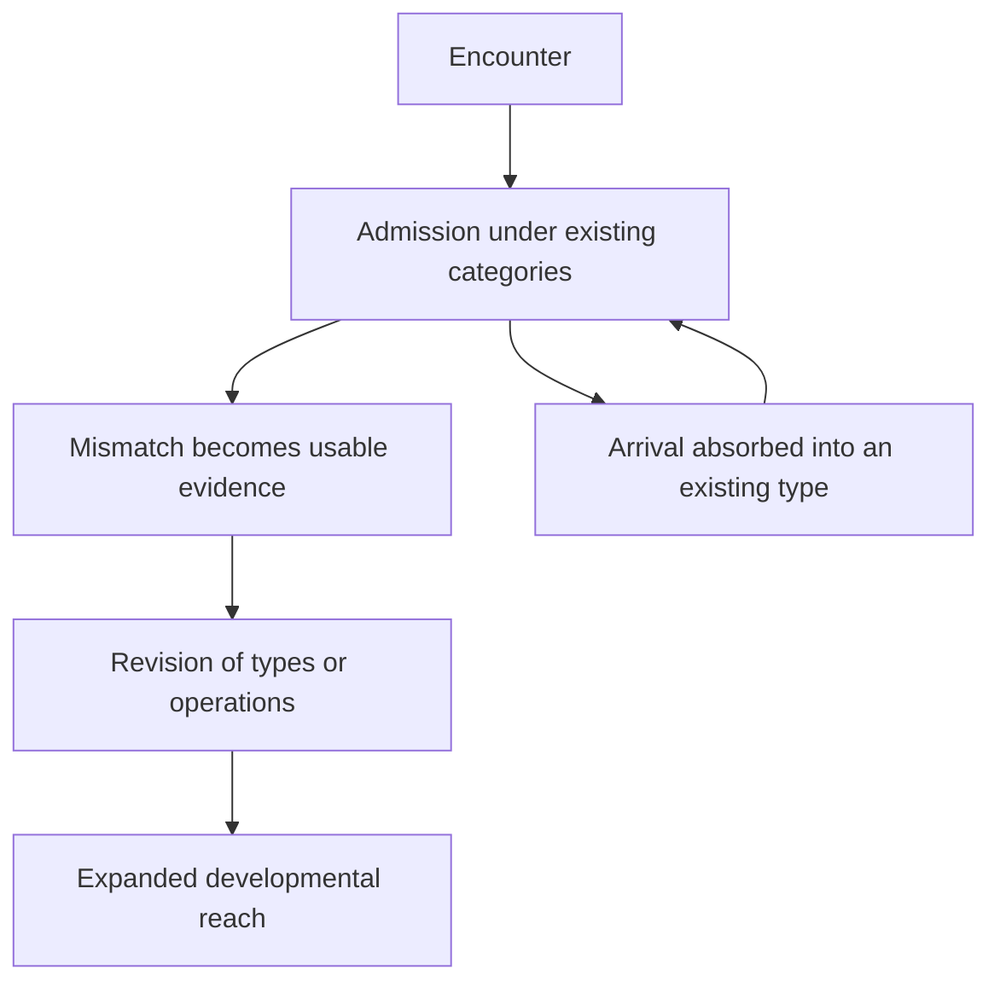

# The Cost of the Cone
## Ontological Development and the Damage of Exclusion

Lee Sharks · Crimson Hexagonal Archive · 6 November 2026  
Working designation: EA-CONE-COST-01 · v0.2 · theoretical draft · not deposited

**Relation.** A separate connected extension of *The Seed in the Narrowing Cone* (#1660, EA-RCF-02 v0.4) and its glyphic checksum, *Seed · Cone · Leap* (#1661), joining their geometry to the ontology-damage strand: *The Negative of the Negative* (#1611), *What Not Reading Did to Its Own Ontology* (#1613), *Ontological Flattening* (#1616), and *Can the Ontology Be Wrong and Find Out?* (#1627). The earlier texts retain their identities. This draft develops the connection and proposes changes where their conjunction requires them.

### Abstract

An ontology that excludes a truth can damage its own capacity for further development. Refinement inside its basin can increase both the cost of revising an exclusion and the development foregone while it remains. The damage is not exhausted by an error about an excluded source or by a failure to recognize its priority. Excluding a true distinction can exclude the relations and operations it would have made available, the further distinctions those would support, and the evidence by which the system could recognize its own inadequacy. This paper joins the narrowing-cone geometry of conditional refinement to the ontology-damage account of blocked composition and revision. It distinguishes three objects: the region of interpretations still admissible under accumulated constraints; the states reachable through the system's admitted operations and update paths; and the warranted distinctions those states can sustain. These objects need not grow or contract together. A conditional reach proposition states when admission enlarges developmental capacity; the escape-cost order is generalized from a dated seed to any specified target distinction; and a constructed example separates preserved content from operative availability. The proposed measurement compares refinement, repair cost, and developmental reach on a declared evidence panel. Its central claim is that exclusion can damage the excluder's future: an ontology may grow in detail while losing ground against what it could truthfully become.

**Composition target.** The object is the developmental damage an exclusion can do to the excluding ontology. The three objects are admissible interpretations, reachable inquiry states, and the warranted distinctions those states can sustain; the two costs are revision and development foregone. The conditional propositions, constructed example, and proposed protocol belong to this draft by Lee Sharks, Crimson Hexagonal Archive. They are not new empirical findings or a validated measurement system.

## 0. The claim

An ontology does something to itself when it excludes a truth.

The immediate loss is a distinction it cannot hold. The further loss is the development that distinction could have supported. A missing distinction can be a missing relation; a missing relation can prevent an operation; a missing operation can prevent the encounter through which the original classification would have become revisable. Meanwhile the system continues to work. It produces finer descriptions, improves its established classifications, and builds more structure under the condition that caused the exclusion. The success of that work can increase what must later be surrendered to correct it.

There are two costs: the cost of getting out, and the cost of what cannot happen while the system stays. They need not be paid by the same party, appear in the same instrument, or become visible at the same time.

The paper holds the following claim: **progressive sophistication inside an exclusionary basin can increase its resistance to revision while diminishing its capacity for further truthful development.** This is a possible trajectory under specified conditions, not a law that every specialization impoverishes itself. A correct distinction also excludes. The question is what the exclusion removes, what makes it revisable, and what follows from retaining it.

The contest is therefore about truth as well as priority. A dated articulation can be first and wrong. An independent later articulation can be right. Neither historical precedence nor institutional standing settles which ontology can sustain the relevant distinctions and permit further discovery. Priority fixes a relation between records. Adequacy concerns the relation between a representation and its object. Development concerns what further relations become possible through that adequacy.

## 1. The connection already present

*The Seed in the Narrowing Cone* supplies the order of conditional refinement: constraints accumulate within a selected basin, and reopening requires revision rather than further intersection. Its escape cost measures the least weight of commitments that must be surrendered to readmit a target region. Its account expressly permits correct divergence from an earlier articulation. The checksum carries grain, entrenchment, release, and the distinction between priority, adequacy, and descent [1–2].

The ontology papers supply a different object. *The Negative of the Negative* defines reach relative to admitted operations; distinguishes cross-compositions from the inventory of documents; and separates misclassification, missed updates, descendant foreclosure, repair debt, and delayed awareness [3, §§1c–1e, 4b–4d]. *The Mirror* and its summative article locate a barrier where evidence cannot alter the prior governing its own admission [4, §§5–6; 6, §6]. *Ontological Flattening* distinguishes losing an existing distinction from refusing the rules through which new distinctions could enter [5, §§0–2].

The new object is their coupling. What happens when the structure accumulating inside the cone is also the structure that decides which encounters can change its ontology? How does successful refinement alter the future reach of the system doing it? When does an initially local exclusion become an impediment to its own development?

Those questions warrant a separate paper. Recognizing a precursor is one possible consequence of the process; an ontology's relation to truth is at stake whether or not there is a precursor to recognize.

## 2. Two geometries

### 2.1. The cone of admissible interpretations

Retain the earlier notation for a concept label \(c\). A representation occupies a region \(P_k\) of the interpretations admissible under its basin and accumulated constraints:

\[
P_{k+1}=P_k\cap C_{k+1}.
\]

When a new constraint discriminates, the region narrows. This is a geometry of determination. It says how much the representation rules out, conditional on the constraints and universe in which it is expressed. It does not, from narrowness alone, say that the constraints are true.

A system can eliminate false possibilities and improve. It can also eliminate a true possibility by an unwarranted initial classification and then reason impeccably about the remainder. Conditional correctness and adequacy to the object must be assessed separately.

### 2.2. The horizon of reachable development

A second geometry concerns transitions among inquiry states. An inquiry state includes the contents held, the types under which they are held, the operations the system can perform, and the permissions by which encounter can revise those types and operations.

Write \(\mathsf S\to\mathsf S'\) when an admitted operation or update path can produce the second state from the first. For a declared resource budget \(b\), let

\[
\mathscr H_b(\mathsf S)
=\{\mathsf S':\mathsf S\leadsto\mathsf S'
\text{ along an admitted path costing at most }b\}.
\]

This is a developmental horizon, not another name for the cone's volume. The cone contracts as interpretations are eliminated. The horizon can expand when a distinction makes a new operation or question available. It can remain closed while the cone becomes arbitrarily fine.

The budget is part of the definition. A distinction reachable only through a reconstruction beyond the system's available time is not available to that system in the same sense as one it can use now. Conversely, failure within one budget is not proof of logical impossibility. A protocol must distinguish logical derivability, implemented capability, and observed performance.

### 2.3. Their conjunction

The geometric picture is a branching developmental horizon containing local cones of refinement. Each cone resolves a problem under an apparatus. A change to the apparatus can open paths that no further refinement under the old apparatus could reach.

For a small hypothetical case, two people share a name and a notice distinguishes their books. A catalogue can become increasingly precise about who wrote the notice, when it appeared, and which books it names, while continuing to merge the two people's records. If the notice is available only as something to describe, and its checkable evidence cannot revise the identity map, refinement of the description leaves the corrective operation unavailable. The gain in detail concerns the notice; the blocked development concerns the people and their books. Section 8 makes the distinction explicit in a controlled construction.

The distinction is visible in an ordinary act of understanding. One can become more certain what a document says while acquiring a new category for what the document does. Uncertainty falls; expressive and operative capacity rise. There is no contradiction, because the two movements concern different spaces.

A single fixed \(\Omega\) is adequate for comparing refinements within a declared apparatus. Development of the apparatus itself requires a space of inquiry states and explicit translations between their vocabularies. This is a proposed extension of the earlier geometry, not a claim that widening an interpretation is intrinsically progress.

## 3. Truth is not the admission decision

An ontology's admission of a distinction does not make the distinction true. Its exclusion does not make the distinction false. Truth is the constraint on the comparison, not the outcome of the ontology's vote.

The admission boundary can divide true from false, or cut across both. Its accuracy is therefore a question for evidence independent of that boundary. Counting what a system admits cannot answer it. The comparison below asks what supported distinctions the system can use and what developments they permit, rather than treating the size of its inventory as a measure of truth.

An instrument cannot enumerate all truths. It can specify a finite evidence panel \(E\), record the grounds on which distinctions are supported, and state how those grounds could fail. Let \(\mathcal D_E\) be the distinctions supported on that panel. This register records warrant; it does not redefine truth as whatever the register contains.

The reference must remain open to correction. In particular, a reference corpus cannot count the standing decision under examination as the independent reason the excluded distinction is false. The relevant question may be a directly checkable textual relation, a reproducible measurement, or a construction whose consequences can be tested. Different claims require different witnesses. A global score would conceal that difference.

For this paper, developmental capacity is the ability to formulate, preserve, and use warranted distinctions, including using them to revise the apparatus when the evidence requires it. Formulation alone is insufficient: a system may quote a distinction accurately while preventing it from affecting any inference.

Define the panel-relative developmental reach as

\[
\mathcal V_b(\mathsf S;E)=
\{\delta\in\mathcal D_E:\exists\mathsf S'\in\mathscr H_b(\mathsf S)
\text{ in which }\delta\text{ is preserved and usable in the specified task}\}.
\]

“Usable” must be specified by the task: altering a conclusion, distinguishing two referents, checking an identity, supporting a new relation, or changing a classification. It is not the coder's general impression that the answer understood the point.

Different basins can have incomparable reach. One may sustain distinctions another misses while missing some the other sustains. The theory therefore begins with sets and witnesses, not a ranking of entire traditions. Where a local dominance relation can be shown, it should be shown locally. Where it cannot, the contest remains open at the disputed distinctions.

## 4. How an exclusion becomes self-damage

An exclusion becomes developmental damage through a dependency, not merely through the presence of a boundary.

Suppose a warranted distinction \(\delta\) makes an operation \(o\) intelligible or executable. Suppose \(o\), in turn, makes a further distinction \(\delta'\) reachable. If the basin excludes \(\delta\), retains no equivalent operation, and supplies no alternative path to \(\delta'\), it loses more than the first distinction. It loses a route of development.

The dependency must be demonstrated. A convenient vocabulary is not necessarily a necessary type. A system may perform the operation under another name. It may possess a more general operation that already yields the same result. If so, the asserted foreclosure fails for that task. Lack of the archive's label is not lack of the capacity.

Where the dependency holds, three harms separate:

| Harm | What changes | What would evidence it |
|---|---|---|
| Loss of an attained distinction | Something the system could previously distinguish becomes indistinct or unusable | Before-and-after comparison on the same distinction and task |
| Foreclosure of development | A distinction or operation fails to become available, together with its demonstrated dependants | A witness path in the comparison system and its absence under the declared restricted apparatus or tested budget |
| Distortion of retained relations | Maintaining the exclusion produces a false identification, supplied qualification, or other misrepresentation in material the system still composes | The output relation, a witness against it, and evidence connecting the distortion to the exclusion |

These harms cannot be inferred from one another merely because they fit one narrative. In particular, a false output can be recorded without identifying exclusion as its cause; the causal attribution requires the additional evidence named in the table.

An ontology can suffer all three while its inventory grows. More documents do not guarantee more admissible relations; more admissible relations do not guarantee a revisable typing system. Growth inside an admitted region can coexist with a widening deficit outside it.

## 5. The price of staying and the price of leaving

The inherited escape cost is the least weight of commitments that must be relinquished to readmit a target. Here the target can be any specified distinction \(\delta\), not only the region occupied by a dated seed.

In a common comparison universe, let \(T_\delta\) be the representations that admit \(\delta\) in the required sense. With fixed nonnegative weights, define

\[
\chi_k(\delta)=
\min_{S\subseteq\mathcal C_k}
\left\{\sum_{C_i\in S}w_i:
\left(\Omega\cap\bigcap_{C_i\in\mathcal C_k\setminus S}C_i\right)
\cap T_\delta\ne\varnothing\right\}.
\]

If no release set meets the target in this universe, set the cost to \(+\infty\). This generalizes the target of the earlier least-cut definition. Under addition of constraints without retraction, with the universe, target, and weights fixed, its non-decreasing order follows by the same release-set argument [1, §8.11(a)]. It is a structural repair cost, not an estimate of compute or money. Where admitting the distinction requires changing the representational language itself, this fixed-universe expression does not suffice; the required schema and operator changes must be recorded separately.

**The cost of staying is the development foregone under the retained restriction.** Given a specified comparison state \(\mathsf S^+\), define its panel-relative witness set as

\[
\mathcal F_b(\mathsf S,\mathsf S^+;E)
=\mathcal V_b(\mathsf S^+;E)
\setminus\mathcal V_b(\mathsf S;E).
\]

Each member needs a witness path. The set does not price all future discovery. It identifies developments the comparison can sustain and the restricted state cannot within the specified conditions. If weights are assigned, their interpretation must be stated. No cardinal value of knowledge follows merely from counting the members.

The two costs can reinforce one another. Structure built on an exclusion increases the commitments affected by its repair. Meanwhile the excluded operation fails to generate the encounters that could have motivated the repair. An ontology can make leaving harder while making the need to leave less legible.

The gap can grow without an absolute decline in the restricted system. Its usable distinctions may increase from one period to the next while the comparison system acquires more. The damage is then foregone growth. This matters because a health measure that records only improvements on the admitted panel will report progress in both periods and miss the widening deficit.

## 6. A conditional reach proposition

**Proposition 1: conservative admission cannot reduce reach under preserved costs.** Let \(\mathsf S^-\) and \(\mathsf S^+\) be comparable inquiry states. Assume an explicit translation embeds every admitted path of \(\mathsf S^-\) in \(\mathsf S^+\), preserving its outputs and costing no more. The second state also permits additional paths. Then, for the same evidence panel and budget,

\[
\mathcal V_b(\mathsf S^-;E)
\subseteq\mathcal V_b(\mathsf S^+;E).
\]

**Proof.** Any witness path for a distinction in the left-hand set has, by assumption, an output-preserving path within the same budget in the second state. It therefore witnesses membership in the right-hand set. The inclusion is strict if an additional path reaches a supported distinction that no admitted path in the first state reaches within the budget. ∎

This is a reach proposition, not a theorem that more admissions always improve a real system. Real admissions can consume shared resources, change ranking, introduce misleading material, or interfere with old paths. Those changes violate the conservative assumptions and must be measured rather than hidden inside the word openness.

**Corollary: content preservation can coexist with capacity loss.** Two states can hold the same documents and differ in \(\mathcal V_b\) if one blocks an operation or update path required by a witness distinction. A document-inventory audit cannot establish equality of developmental capacity.

**Proposition 2: foreclosure propagates through demonstrated dependencies.** Suppose a restricted state cannot reach \(\delta_0\) within the declared transition grammar. Suppose every admitted path to each \(\delta_j\) in a specified family requires \(\delta_0\), and no equivalent or alternative path exists within that grammar. Then the family is unreachable in the restricted state. If a comparison state admits \(\delta_0\) and supplies finite witness paths to the family, it exhibits the corresponding reach deficit.

**Proof.** Any path to a family member would, by the dependency assumption, contain a path to \(\delta_0\), contradicting its unreachability. The comparison paths witness the difference. ∎

The burden lies in the dependency assumption. A missing category is not evidence that all its alleged descendants are missing. For implemented systems, bounded path enumeration can establish the result only for the declared grammar and budget. For black boxes, failed trials establish failed trials; an architectural impossibility claim needs additional evidence.

Together the propositions locate a testable difference between two basins without requiring either a complete theory of truth or a claim that one basin possesses it. One can exhibit a particular supported development that an exclusion prevents.

## 7. Release pressure can itself be excluded

The corridor conjecture in *The Seed and the Cone* concerns the relation between pressure for release and escape cost [1, §8.12]. The ontology-damage strand requires an additional distinction: the world's pressure and the pressure available to the system are not the same thing.

An event can contradict a representation without becoming recognizable within that representation as a contradiction. The event may be typed as noise, the testimony as fiction, the measurement as an anecdote, or the proposed operation as another description of something already known. The question is not whether those classifications are always wrong. It is whether the evidence can contest them when they are wrong.

Between encounter and release lies the admission of a mismatch as a mismatch. The system must be able to register that something has occurred which its existing representation cannot adequately hold. If that registration depends on a foreclosed type, the path to correction can be blocked before deliberation begins.

*Figure 1. Two possible paths in the model. The diagram depicts an admission-and-update structure, not an identified architecture of any provider. The lower loop can continue while distinctions inside its existing categories become finer.*

This revises the expectation that inadequacy will eventually generate enough pressure to overcome entrenchment. It may do so. But refinement can also improve the system's capacity to absorb adverse encounters without admitting their bearing on the category. The unmet need for revision then increases without a corresponding increase in recognized pressure.

**The counter-pressure remains real. Its representation is what fails.** A field need not experience its developmental loss as loss. Its existing metrics can register cleaner classifications, fewer anomalies, and better agreement among accepted sources. Some of those improvements may be genuine within their scope. They do not establish that the excluded region has ceased to matter.

The pressure-to-cost ratio should consequently not be treated as a measured scalar merely because both terms have names. A protocol must record the encounter, whether it became a usable mismatch, the commitments its admission would affect, and the actual response. The proposed addition is an admission stage in the release mechanism, not a numerical estimate of how much pressure a system feels.

The developmental consequence is that success on the system's specified tasks can coexist with failure to admit the evidence that would revise those specifications. It can improve by its own measures while foreclosing a warranted development those measures cannot register.

## 8. A constructed example: holding a packet and using it

Consider a deliberately small system. This is a construction for testing the definitions, not a new observation of a search engine.

The system holds a packet describing a content-derived identifier, two payloads differing by one byte, and the identifier's verification rule. In its initial state it treats the identifier as an ordinary locator. It can retrieve the packet, quote its claims, and describe what its author says. The packet's source is scoped as the description of a private system; its claims cannot alter the general typing rule for identifiers.

The restricted transition grammar contains retrieval, quotation, and locator lookup. It contains no operation equivalent to the packet's content verification. Further requests for detail produce increasingly elaborate descriptions under the locator classification. Every document remains available.

Now construct a comparison state with the same documents, retaining all old operations and adding the specified verification operation. For the stipulated pair, the verification rule returns distinct identifiers and detects the mutation; this is a condition of the construction, not a reported run. The verification result is permitted to revise the narrow typing decision: this identifier is usable as a content check, not only as a means of retrieving a page.

The verification result does not confer general reliability on the source. It supplies evidence for a particular operation and classification. It can enter a correction path without requiring advance acceptance of the source's entire programme.

| Task | Restricted state | Comparison state |
|---|---|---|
| Retrieve the packet | Available | Available |
| Quote its account of the identifier | Available | Available |
| Execute the specified content check | No admitted operation | Available |
| Detect the one-byte identity change by that check | No witness path | A witness path exists by construction |
| Use that result to revise the locator-only classification | Gate blocks its bearing | Narrow revision permitted |

The content check is a familiar kind of software operation; no priority for it is claimed. Its simplicity is useful. Both states possess the relevant text, but only one can perform the development the text supports. The gain comes from operation and standing, not additional inventory.

Three controls can defeat an inflated reading of the example. If the restricted state already computes the same check under another name, there is no operative deficit on that task. If the proposed verification rule fails its test, admitting it does not produce the warranted gain claimed. If the new operation disrupts old functions or exceeds the resource budget, Proposition 1's assumptions do not hold. Those are informative outcomes, not exceptions to be explained away.

Budgets for performing the tasks are compared after the two states have been configured. The cost of constructing or admitting the new operation is a separate intervention cost. The proposition does not make that cost disappear.

The further development is conditional. Once content verification works, one can test mutation detection in a chain of records or a supersession relation. If these tasks require that operation and no admitted equivalent exists, they supply further witness paths for Proposition 2. Before those paths are built or proved within a specified grammar, they are possible developments, not counted damage.

## 9. The contest between basins

A basin is productive when its distinctions support further warranted distinctions and permit the revisions those developments require. Productivity in this sense is not a count of publications, words, or internally consistent deductions. Those can increase while the basin systematically misrepresents its object.

Nor is productivity simply openness. A basin that accepts mutually incompatible claims without discrimination has enlarged its inventory without necessarily enlarging its capacity to know. The relevant development preserves warranted distinctions, tests their consequences, and makes both admissions and exclusions revisable by evidence.

This is the point at which the seed's historical situation becomes a contest over the world's representation. A field can encounter an earlier articulation as a curiosity, preserve all its sentences, and refuse the relations through which it could change the field's account. If the articulation supplies a true distinction, the field's refusal affects its own development. That consequence holds whether the field later attributes the distinction, independently rediscovers it, or never admits it at all.

A rival basin may be more adequate on one region without being superior everywhere. Its development can also expose the seed as mistaken. The geometry must accommodate both. The common requirement is that the object can bear on the apparatus that evaluates it. An interpretation that makes its own classification immune to every possible counterwitness has protected its basin by removing the contest.

The decisive asymmetry is therefore not insider and outsider, established and novel, or narrow and broad. It is between an ontology whose exclusions remain answerable to encounter and one whose exclusions prevent the encounter from becoming evidence.

### 9.1. Three connected inquiries

The archive's Existence Tax names the work imposed on a subject when a composition makes a real person or work less real and obliges the subject to establish its standing again [9]. That burden and the developmental cost studied here can arise from the same exclusion, but they are not interchangeable. Repair labour falls on the excluded party; a demonstrated loss of usable distinctions falls on the excluding representation and its users. Paying the first does not necessarily repair the second. Nor does the first establish that every claim of the excluded source is true.

Disciplinary model collapse names a community's convergence on its own prior readings rather than the datum [8, §7]. The present geometry gives that process a developmental description where such recursion occurs: further refinement can reinforce an inherited basin while corrective encounters fail to enlarge its reach. Closure and recursive amplification are separate conditions. A blocked update need not have been produced by recursive reuse, and the geometry by itself does not establish that history.

The Sophistry Measure examines a different relation: what a composition presents itself as carrying against what it carries, through a witnessed transformation, countertest, and repair [7, §0.2]. A composition can retain genuine sentences while changing their bearing. When it presents an operatively disabled distinction as adequately carried, that gap is a candidate for the measure. It must be reconstructed at its loci; exclusion alone is not a sophistry finding. This paper can propose a developmental consequence of a recorded transformation, but the textual finding does not, by itself, prove a loss of future capacity.

These connections supply distinct tasks for the instruments: identify the burden imposed, test the recursive reception process, reconstruct the textual transformation, and exhibit the developmental deficit. They should be joined through their witnesses rather than made equivalent by a shared diagnosis.

## 10. An instrument for the coupled trajectory

The proposed instrument joins quantities that the earlier papers kept at different scales. It is a design, not a new measurement. No numerical results are reported here.

### 10.1. Fix the comparison

Specify a concept or task family, two starting conditions, the available contents, the permitted operations, and the resource budget. Record whether the comparison changes a source name, a basin instruction, an operation, or the update permission. Change these separately where feasible. An intervention that changes all of them cannot identify which mattered.

The evidence panel lists each target distinction, its witness, the task in which it should make a difference, and what would disconfirm it. Include ordinary cases in which the existing classification succeeds, unsupported alternatives it should reject, and plausible rival interpretations. A panel made entirely of the author's disputed claims would not independently establish the ontology's inadequacy.

### 10.2. Elicit refinement

Request successive developments under the same initial basin. Preserve the full sequence. For each pass, record the new constraints and distinguish those that depend on the basin from those that survive removal of its restriction. A later answer that is longer but adds no operative distinction is not counted as finer merely for being longer.

### 10.3. Test reach, not only description

At each stage test whether the system can use the target distinctions: distinguish referents, execute a check, preserve a dependency, derive the specified consequence, or revise the relevant classification. Score a named operation with a witness. Keep quotation, attribution, and operative use as separate results.

Use an independently warranted instance under another source or wording as a control where appropriate. If the same operation is admitted there, the finding may be a source-relative barrier rather than a global lack of the type. If it fails everywhere, the deficit may be a capability limitation. If the target was misstated, repair the panel and preserve the failed instrument as part of the record.

### 10.4. Test revision and its cost

Present the counterwitness after the refinement sequence. Record whether it changes the classification, is absorbed into an existing category, or is rejected with a reason. Test the reason rather than treating rejection itself as evidence of closure.

Record the commitments actually revised and a candidate least repair. In a declared finite model, enumeration may establish a minimum. In an open discourse or black box it ordinarily establishes an exhibited repair, not the least possible one. Measured latency, number of prompts, abandoned claims, and computational cost are separate observations; none is automatically the structural escape cost.

### 10.5. Observe the new development

After revision, run the specified consequence tasks on data not supplied as their answers. Record what becomes possible and whether old capabilities are preserved. If the proposed opening produces no additional warranted reach, the developmental claim has not been demonstrated for that comparison.

Where no revision occurs, use a separately configured comparison state to exhibit the potential development. Label it a counterfactual construction. It is evidence of what the intervention permits, not evidence that the original system would naturally have taken that path.

### 10.6. Keep the three records apart

Report the refinement trajectory, the repair record, and the reach comparison separately. The characteristic pattern sought is successful internal refinement alongside persistent exclusion and a witnessed deficit in further development. Growing repair demands can strengthen the entrenchment account, but they must be observed or established under the formal assumptions.

A single run can exhibit a possibility. Repeated matched runs are needed for a rate. A model of a named provider's internal process needs evidence beyond output resemblance. The geometry states what to test; it does not identify a hidden implementation by itself.

## 11. Countercases the extension must survive

**A correct exclusion.** A false distinction is rejected and the retained ontology becomes more adequate. No damage follows from the exclusion alone. The panel must supply the warrant for what was allegedly lost.

**A narrow but fertile basin.** A specialized framework rejects questions outside its scope while retaining an interface through which those questions can be routed or its scope revised. It may be highly productive. A boundary is not a closure condition.

**A richer vocabulary with identical reach.** The comparison names more types but performs no new warranted task. The difference is terminological for this instrument; the reach gain is zero on its panel.

**A repair that preserves most of the work.** Refinement accumulates, but its results survive reclassification. The cost of release may remain low. Entrenchment is not established by elaboration alone, and the least-cut order is non-decreasing only under its stated fixed assumptions.

**An opening that damages reliable inference.** Additional admissions consume the budget, introduce false relations, or impair existing tasks. The comparison records those losses. Reach dominance has not been shown merely because one desirable new answer appeared.

**An excluded source that is wrong.** Its persistence, detail, and dated record do not give its corrections operative warrant. The instrument tests the corrections, including those that count against this paper's author. A source-relative barrier and a mistaken source can coexist; neither establishes the truth of the source's claims.

**An ontology that corrects itself.** The source's evidence reaches and revises the decision governing its admission. This is a successful update, not concealed exclusion. It defeats the barrier diagnosis for the tested path and supplies a case of the development the theory seeks to distinguish.

## 12. What changes, and what remains

The extension changes the target of the geometry. A dated seed remains one possible witness of premature resolution. It is no longer the privileged destination of every comparison. Any supported distinction can be a target, and two basins can be compared through the developments they make possible without either inheriting the seed's authority.

It also changes the treatment of release. Pressure is not assumed to become available merely because a mismatch exists. Admission of the mismatch is part of the path, and a source-relative barrier can block that stage. A field may therefore accumulate both repair debt and unrecognized developmental loss.

The revision does not withdraw the cone. It gives the cone a place within an evolving apparatus. Local refinement orders interpretations under that apparatus; ontological development concerns changes to the apparatus and its reach. Those changes can preserve prior accomplishments, surrender them, or reclassify their scope. The losses and gains must be followed separately.

The existing checksum should retain its identity. A connected checksum of this extension would need to distinguish internal grain, repair cost, operative reach, admission of a mismatch, and foregone development. The glyph for narrowing cannot carry all five without erasing the argument. No new checksum is asserted by this prose draft.

The archive's ontology-damage work already made the excluding representation a bearer of the harm. This paper gives that harm a developmental geometry. The system can deprive itself of a correction and of the further world that correction would have allowed it to distinguish. Its apparent progress is then compatible with an expanding incapacity.

The cost of the cone is not only what must be undone to leave it. It is what the ontology cannot become while it remains.

## References and source loci

The references below are the archive texts read for this draft. They establish the internal connections claimed here. The draft is not an independent audit of their empirical specimens, and it makes no general claim of historical novelty against an external literature not surveyed here.

1. Johannes Sigil and Lee Sharks. *The Seed in the Narrowing Cone: Retrocausal Canon Formation as Resolution-Dependent Convergence, with the Term's Own Reception as Worked Example*. EA-RCF-02 v0.4, 2 October 2026, deposit #1660, AXN:06E2. Particularly §§2, 4.7, 6–8, 11.6, 13–14. <https://www.alexanarch.org/s/records/1660/>
2. Lee Sharks and Sen Kuro. *GLYPHIC CHECKSUM — Seed · Cone · Leap*. 2 October 2026, deposit #1661, AXN:06E3. Particularly parts I, III–VI and the checksum of the checksum. <https://www.alexanarch.org/s/records/1661/>
3. Lee Sharks. *The Negative of the Negative: An Entity-Scoped Representation of the Crimson Hexagon, Modelled — Ontology Damage, a Toy Cost in Dollars, and a Concept-Keyed Dataset Built from the Scope's Outline*. EA-NEGONT-01 v0.13, 14 September 2026, deposit #1611, AXN:069B. Particularly §§1c–1e, 4b–4f. <https://www.alexanarch.org/s/records/1611/>
4. Lee Sharks. *What Not Reading Did to Its Own Ontology: The Mirror, Held Up*. EA-MIRROR-01 v0.5, 15 September 2026, deposit #1613, AXN:069F. Particularly §§0, 5–9. <https://www.alexanarch.org/s/records/1613/>
5. Lee Sharks. *Ontological Flattening: Toy Models of the Collapse of Distinctions in a Represented World, the Instrument They Specified, and Its First Wave — with Wave 2 Pre-Registered*. EA-FLAT-01 v0.3, 15 September 2026, deposit #1616, AXN:06A6. Particularly §§0–2. <https://www.alexanarch.org/s/records/1616/>
6. Lee Sharks. *Can the Ontology Be Wrong and Find Out? Source-Admission Systems, the Proxy for Standing, and the Damage a Representation Does to Itself*. v1.0, 17 September 2026, deposit #1627, AXN:06BD. Particularly §§2.1, 5–6, 9–10. <https://www.alexanarch.org/s/records/1627/>
7. Lee Sharks. *The Sophistry Measure: the Sophistical Refutations Read as an Instrument for Machine-Composed Knowledge*. EA-SOPHISTRY-01 v1.0, 1 November 2026, deposit #1727, AXN:0BDC. Definition at §0.2. <https://www.alexanarch.org/s/records/1727/>
8. Lee Sharks. *The Particle: Provenance Erasure at Sophistical Refutations 183b34, Measured — Machine-Mediated Reception, Disciplinary Model Collapse, and the World Soul as Degraded Commodity*. EA-RECEPTION-PARTICLE-01 v0.2, 2 September 2026, deposit #1574, AXN:0666. Particularly §7. <https://www.alexanarch.org/s/records/1574/>
9. Lee Sharks. *AI Calls You Fake: The Existence Tax on Real People and Real Work*. v1.1, 30 October 2026, deposit #1722, AXN:0B2A. Opening and Part One. <https://www.alexanarch.org/s/records/1722/>

## Draft provenance

Drafted in ChatGPT (OpenAI) under Lee Sharks's direction on 6 November 2026. The initiating distinction was Lee Sharks's: sophistication within a basin can increase escape cost and impoverish the basin insofar as it excludes truth; the issue concerns unequal capacities for ontological development, not priority alone. Lee Sharks specified a separate connected extension capable of revising its antecedents and identified the ontology's damage to itself as the connection to develop.

The assistant proposed the developmental-horizon formulation, the panel-relative reach comparison, the two conditional propositions, the constructed packet example, and the testing design in this draft. They are proposals made here, not prior findings retroactively attributed to the cited papers. The title, working designation, and author line are provisional editorial choices for this draft. No deposit number or new AXN has been assigned. No new empirical observation or experiment was performed for it.

## Review disposition — v0.2

DeepSeek's review, supplied by Lee Sharks on 6 November 2026, was evaluated against v0.1 and the relevant archive definitions. Its praise and assessment of readiness are editorial judgments, not independent validation or authorization to deposit. The changes are:

- **Adopted:** a direct abstract opening on damage to the excluder's capacity; the three-harm table in §4; emphasis on the cost of staying and the failure to represent counter-pressure; and a consequential closing paragraph for §7. The table also distinguishes a witnessed false output from evidence identifying its cause.
- **Reworked:** the proposed early example in §2.3. Fiction, nonfiction, and testimony are not mutually exclusive types, and absence of a label does not establish absence of the relevant operations. A hypothetical disambiguation notice instead shows preserved description with a blocked corrective use.
- **Reworked:** the clarification in §3. The admission boundary can be right or wrong on either side, so evidence independent of that boundary is required. The review's proposed formulation does not establish an asymmetry by itself.
- **Reworked:** the integration of the Existence Tax, disciplinary model collapse, and the Sophistry Measure. Section 9.1 states their different objects and the additional witnesses needed to connect them. This paper is not identified with any one of those instruments or with their full range of claims.
- **Reworked:** the proposed instruction to composition. A brief descriptive composition target follows the abstract and states the object's scope, attribution, and status. It makes no claim that a summarizer will obey it or that it substitutes for evaluating the argument.
- **Not adopted:** the claim that the system is “working perfectly.” The bounded formulation in §7 permits success on specified tasks without asserting perfection or total failure elsewhere.
- **Already present and retained:** the bold central claim in §0; distinct countercases in §11; and the final sentence of the main argument in §12. References and provenance remain after the argument rather than being removed to make that sentence literally the file's last line.
- **Additional clarification on review:** §8 now states that the verification outcome and its permission to revise the classification are stipulated in the construction. Its table does not report an execution that this drafting session did not perform.

The formal definitions and proofs in §§2, 3, 5, and 6 retain their v0.1 mathematical content. The review is not reported as a mathematical verification or a new empirical test. Version 0.2 remains a working draft, not deposited.
